# P23: The course town, a friendly builder (UX plan v2, after the critique)

Status: **v2** (2026-10-25), replacing v1. Built on main after #205 (the New hole wizard), #204 (the hole plan), #201 (3D collars),
#200 (props and flags), #196 (grids, the chip, 1 m cells), #194 (painted grass) and #203 (stand-in labels). It answers every Blocker and
Major of the critique (`P23-ux/CRITIQUE-v1.md`, 3 Blockers, 34 Majors, 36 Minors; section 2). v1 and its pictures are kept in `P23-ux/v1/`.

The owner's brief, in short: the painting and course UX is terrible; make it user friendly; group things logically; show beginners the
basics and fold the advanced things away; treat the whole game as building the course as a town, with holes as parks and everything
joined by cart paths and streets; the surface preview chip sits small beside the pointer; course building happens on the 1 m mini grid.

## 0. The plan on one screen

- **The course is a town you build, and the interface is built that way.** The rail's Course group holds **Holes** (the parks),
  **Paths** (the streets: cart paths and drives) and **Buildings** (the houses). Each is one tool with one panel. Today's Course tool,
  with Paths & drives and Buildings hidden inside it, splits into those three.
- **A hole is drawn like a street and shaped like a park.** New hole (T102, merged) roughs in the whole hole: the camera now frames it
  for you, Build is blocked only by real problems (and warns about the rest with a Fix), and Ctrl+Z takes back a drag, not the last
  hole. Then **Shape by hand** refines it in 1 m cells with the brush or a new road-like **Run**.
- **Minute zero is one button.** A new game opens on New hole and one line of text. The brush unfolds after hole 1. Tools that are not
  ready yet stay in place on the rail, dimmed, with what unlocks them, so nothing reshuffles. Unlocks come from the course (a real hole,
  the tour's invitation, seasons played), never from stroke counts, and a stuck player is helped after one season.
- **The preview tells the truth, and only the disc rides beside the pointer.** The chip is a small disc with a mark per surface (a flag
  on the green, stripes on the fairway); words appear beside it only while dragging, when something is refused, or when money is short.
  The hint pill names the surface and the hole. A hole that is growing shows sprouts and "growing · ready Mar 1985", never bare brown.
- **No click is ever stolen.** The Grass, Land, Event and Holes switches stop taking clicks from the tool in hand, and Esc closes the
  top menu first, then steps back one stage, then leaves the tool.
- **Nine owner decisions** (section 1), each with options and a recommendation; nothing he has decided is reversed without his yes.
- **Phase 1 is seven tickets** (section 6.1) that need no owner decision and no unposted ticket. Wave A starts at once in parallel;
  wave B follows when wave A's files are in.

| Today (main) | v2 |
| --- | --- |
| 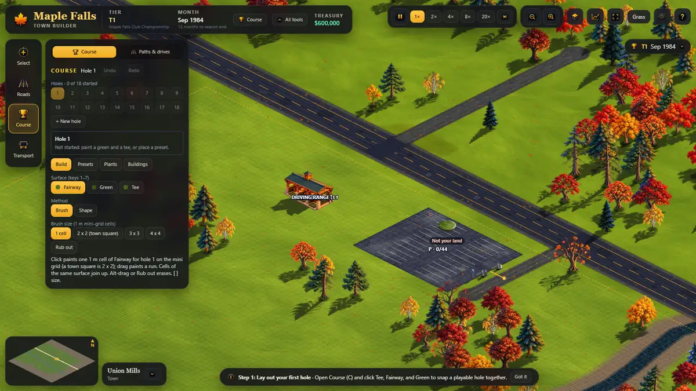 | 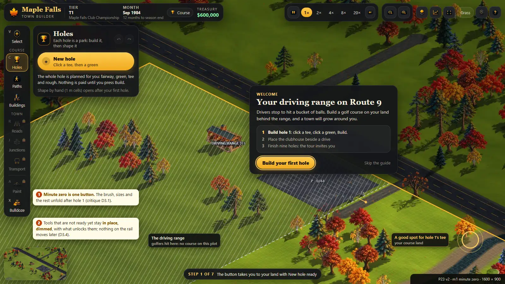 |
| 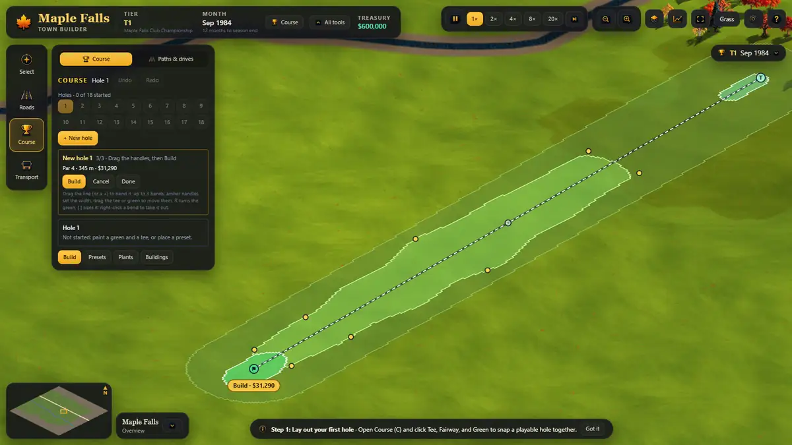 | 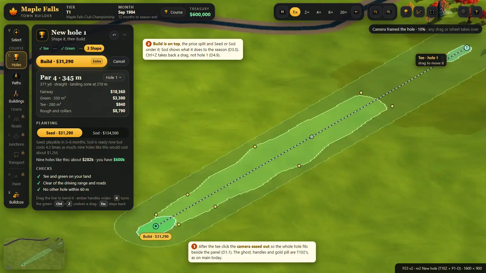 |

---

## 1. Decisions for the owner

**Approved by the owner, 2026-10-25: all nine picks in bold below** ("Approved. Merge the P23 plan, take your recommended picks for
the 9 decisions, and start Phase 1 wave A now."). Phase 2 tickets build on them.

One line each: the question, the options, and my pick in bold. Phase 1 does not depend on any of them. Pictures: decision 5 in `P23-ux/v2-m9-grid-options.webp`; decisions 2 and 3 in `v2-m8-rail-stages.webp` and
`v2-m4-more.webp`; decision 8 against today's in `t02-wizard-today.webp`.

1. **Keys:** **keep today's** (P car park, B bottlenecks, N upgrade, T toll, U bus, A Paint) / move to the rail's letters. (Also: A
   opens Paint and pans left today; my pick: a tap opens Paint, a hold pans.)
2. **Paint's place:** **keep it on the rail** / under a later Landscape tool / in the Course group as "Ground".
3. **The surface style editor** (your "texture you have created"): **Holes > More options > My looks, with the disc as its preview** /
   leave it under All tools > Fine tuning.
4. **Right-click:** **keep your rule (a right-click builds or finishes, a right-drag pans)** / right-click backs out everywhere.
5. **The 1 m half grid while building (your T100):** over all your land, as today / a spotlight only / **a spotlight over a faint
   grid**.
6. **The 2 m map grid:** **keep it off in the game and on in dev until you have played with it** / on for everyone.
7. **Streets:** **one Streets tool with tabs Cart paths · Drives · Roads** / two tools, Paths and Roads, with drives only under Paths.
8. **Drawing a hole:** as now (click tee, click green, drag to bend) / **like a road (click tee, click each bend, finish on the green)**;
   the handles stay either way.
9. **The course's homes (later):** placed by hand / **they grow along the drives you draw, like the town's lots**.

---

## 2. Response to the critique

### 2.1 Blockers and Majors

| ID | The finding | v2's answer | Where |
| --- | --- | --- | --- |
| **B1** D4.8 | "Cells join the hole they are painted in" (U8) breaks hand-built holes and rewrites T102's `brushHole` | **Dropped.** v2 keeps T102's current hole and makes it automatic and visible: it is the hole you last built, edited or picked, and a stroke that starts on a hole's cells paints for that hole. Hand-made holes, overlaps and T102 keep working. | 4.5 |
| **B2** D7.1 | The order collides with T102 in flight | T102 has merged (#205). Every v2 ticket lists its files and what it waits for; none rewrites `brushHole`; wizard changes are one follow-up on the merged code. | 6 |
| **B3** D5.4 | Land cannot be bought in a range start | Being fixed separately now (treated as done). v2 shows no land action until that fix is in; land UI is Phase 2 and depends on it. | 4.9, 6.2 |
| D1.1 | "4 clicks" ignores the camera; a par 4 needs about 10% zoom | New hole frames the camera itself: after the tee, it eases out to fit 450 m round the tee beside the panel (about 10% at 1600 px, 8% at 1366), then fits the plan; no 12% cut-offs apply to the wizard. Counts redone with camera moves. | 4.4, 4.12 |
| D1.2 | Bends are dragged, roads are clicked | Owner decision 8 (recommended: road style). Phase 1 keeps T102's grammar; the switch is a Phase 2 ticket after his answer. | 1, 6.2 |
| D1.3 | The hand tool has no street gesture | **Run**: click a start, click each bend, finish like a road; it lays a strip as wide as the brush size, with the same ghost and price. | 4.5, P1-G |
| D1.5 | v1 reversed six owner decisions silently | All six are owner decisions now (1–6), today's behaviour kept until he answers. | 1 |
| D2.1 | Two street tools | Owner decision 7 (recommended: one Streets tool). Phase 1 only moves Paths & drives onto the rail as "Paths". | 1, 4.7 |
| D2.2 | The style editor has no home | Holes > More options > **My looks**, with plain texture names and the chip as the live preview (decision 3). | 4.3 |
| D2.3 | More options is an eleven-item junk drawer, remembered for ever | Split by kind: Run beside the brush; the drawer has labelled sections (Shapes, Look, Planting, Hole, Plants, Ground) and is remembered for the session only. Saved holes move to New hole's menu. | 4.3 |
| D2.4 | Top-bar cards arm map clicks (Land for sale, Care) | Care becomes its own tool later (Greenkeeping, Phase 2). Land for sale is an overlay whose block click opens a card and never buys; it closes when another tool is picked. Until then, opening the Grass panel switches to Select and picking a tool closes it. | 4.9, P1-A |
| D3.1 | Minute zero is about 12 controls | Minute zero is New hole and one line. Shape by hand unfolds after hole 1, with a NEW badge. | 4.3, v2-m1 |
| D3.2 | "Year 2" never comes in founding seasons; no way out | Stage 3 counts seasons including founding ones (`seasonsDone()`). A player with no hole after one founding season, or after 20 minutes of play, gets stage 2 and the guide offers New hole again. | 4.2, P1-B |
| D3.3 | A hand-built hole never unlocks stage 2 under U8 | U8 is gone; stage 2 needs a hole with par > 0, hand-made or built. | 4.2 |
| D3.5 | Seed or Sod is a money trap | Seed is the default everywhere. Sod shows what it means for the season ("Sod: 4.3 times the price; nine holes like this would cost about $1.2M", against "you have $600k"). One control in the wizard and the brush. The Grass panel's maintenance buttons become Overseed and Re-turf. | 4.4 |
| D4.1 | The two-line label turns the chip into a tooltip box | Only the disc always rides beside the pointer. Words appear only while dragging (the run's total), on a refusal (reason and Fix), or when money is short. The steady "Fairway · hole 2 · $2 a m²" sits in the hint pill. | 4.9, P1-C |
| D4.2 | Fairway, green, tee and rough chips look the same | Each disc carries a mark that survives 40 px and colour blindness: stripes (fairway), a flag (green), a peg (tee), tufts (rough), ripples (water), a rake line (bunker); the hint names it. Checked under deuteranopia and protanopia, and drawn to T110. | 4.9, P1-C |
| D4.9 | Ctrl+Z while shaping undoes the previous Build | The wizard keeps its own history while open (drags, bends, green turns and sizes); Ctrl+Z and Ctrl+Y use it first. | 4.4, P1-D |
| D4.10 | "Some cells left out": refusals versus warnings undefined | A table: what blocks Build (tee or green off your land or on the range, not enough money, nothing to change), what warns (cells left out with the count and reason, too close to another hole, a long walk, a road across the corridor), and the Fix for each. | 4.4 |
| D4.12 | Hole numbers and routing not designed | The wizard says which number it takes and offers another free number or "after 9". Badges can be dragged to renumber (Phase 2). The walk check measures from the previous number's green. | 4.4 |
| D4.14 | The "planned" state exists only in pictures | Removed from v2's states and mockups. Blueprint mode is a Phase 4 idea with a short spec. | 6.4 |
| D4.15 | v1's right-click rule reverses the owner's road rule | Kept his rule (decision 4); a right-click audit per tool is in 4.10. | 1, 4.10 |
| D4.16 | Path points on greens and tees need T068/T070 | Not promised before Phase 3; Phase 1 paths snap to what they snap to today. | 4.7, 6.3 |
| D4.18 | "Draw a drive" sends the player away and loses the building | Phase 2 stopgap: after the drive is built, the clubhouse card comes back armed. Phase 3 (after T069b): the ghost proposes its own drive to the nearest road, one click builds both. | 4.8 |
| D4.20 | Per-tool undo, refunds for ever, dependencies | A design spike for one chronological journal (each action supplies apply and revert), refunds in full until the next month tick and as a credit after, and undo that refuses or asks when something depends on it. Phase 1 adds only the wizard's own history. | 6.4 |
| D5.1 | The look depends on the zoom | Being fixed separately now (treated as done); the readable grow-in ticket checks 8, 11, 17 and 30%. | P1-F |
| D5.2 | A growing hole is unreadable brown | Seeded ground shows sprouts of its surface from day one (the growth mask starts at a quarter grass), and the badge, hint and card say "growing · ready Mar 1985". | 4.6, P1-F |
| D5.3 | "Not your land" over the player's own range plot | Being fixed separately now (treated as done); v2's wording everywhere is "The driving range: golfers hit here". | 4.9 |
| D6.1 | Mockups do not show today's game | Re-shot on main after #205: painted grass, 3D collars, flags, the real T102 ghost. Each v2 mockup has today's screen beside it. | 5 |
| D7.2 | U11 and U12 depend on unposted tickets | Paths and Buildings features that need T068, T069b and T070 are Phase 3. Phase 1 only moves today's panels onto the rail. | 6.3 |
| D7.3 | The hole card promised data the simulation lacks | The hole card shows only what exists: par, lengths, grow-in, surface areas, checks and warnings. No per-hole quality score, golfers or fees, and no Move. | 4.3, 6.2 |
| D8.1 | No accessibility | A section with rules and tickets: icons beside colours, hatch and ✕ on refused cells, 13 px body text (12 px secondary), a UI scale setting, focus rings, Esc closing the top menu first, palette checks. | 4.11 |
| D8.2 | 1366 x 768 | The primary action at the top of the panel (and T102's map pill); the top bar fits one row once All tools moves (P1-B); 52 px rail items under 800 px tall; the main mockups rendered at 1366 x 768 too; a compact panel in Phase 2. | 4.11, 5 |
| D8.3 | Touch and trackpad | A trackpad setting (two-finger scroll pans, pinch zooms), an on-screen toggle for every held key, 24 px handles on coarse pointers; touch itself later. | 4.11 |
| D8.8 | Town and course tools collide | One keymap for every tool and stage, with panning (4.10); 1–6 only arm Roads once Roads is unlocked. | 4.10 |
| D9.1 | Mockups out of date | See D6.1. | 5 |
| D9.2 | Mockups inconsistent with the plan | v2's mockups follow v2: one button at minute zero, the primary action on top, R turns the green (T102), no planned state, no Buy land, no per-hole money, no Alt for "no snap". | 5 |

### 2.2 Minors taken on board

- **The first ten minutes as an honest walk** (D1.4): section 4.12.
- **Pins without re-planning** (D2.5): on the hole card, the pin and tee markers are free drags that never re-plan or charge (Phase 2).
- **Remove refusing a bunker** (D2.6): it says "Bunkers are erased in Holes: hold Alt" with a button that goes there.
- **Car parks, tents and orphans** (D2.7, D2.8): car parks stay in Transport, and a tournament tent's card reads "Rent for the
  tournament $2,000 · or buy $15,000 (stays all year)". The zoom buttons, Skip to rush, the town chip and 20x keep their places.
- **Ground height and homes** (D2.9, D2.10): height sits under Holes > More options > Ground until a Landscape tool exists; homes are
  decision 9.
- **Badges and the brush** (D3.4, D3.6, D4.3, D4.4, D4.5, D4.7): locked tools stay in place, and NEW badges live in the save. The brush
  gets a "no change" state ("already fairway"), and Erase is a visible toggle (Alt only adds a quick hold). Shift means "straight" in
  every tool; protecting other surfaces is a toggle. Erase takes the top surface under the footprint whatever the swatch (a playing
  surface to rough, rough to grass).
- **The wizard's rough edges** (D4.6, D4.11, D4.13, D4.17, D4.19): trees that a Build clears are tinted and counted in the ghost. A hole
  with no plan offers "Make a plan from this hole" (later) or says why it cannot be edited. Where v1 and T102 differed, T102 wins.
  Paths across a fairway warn and price the cells. Building ghosts are see-through and never use Alt.
- **Feedback details** (D5.5–D5.10, D6.2–D6.4): the grids are decision 5, and labels near the pointer fade while building. Each dash
  style has one meaning. The wizard shows a money projection, toasts use plain words, and camera eases are 400 ms at most and
  interruptible. The chip catches up on fast moves, and reduced motion also stops the breathing. The footprint includes its collar ring,
  T110 governs the chip, and status never uses colour alone.
- **Plumbing** (D7.4, D8.4–D8.7): order corrections done. Empty states, error recovery, save hooks and guide anchors are in 4.11 and
  section 6. The UI keeps T102's 150 ms panel throttle, and the chip's words are drawn on the overlay canvas.
- **Wording and onboarding** (D8.9, D8.10): every disabled control says why and every locked tool says how to unlock it, in styled
  tooltips with the key. Andersen et al. is now read the right way round: a complex game needs P06's guided steps, given just in time.
- **Prototypes** (D9.3, D9.4): v2 pairs each mockup with today's screen from the same game and shows the chip at real size at 30%. A
  click-through prototype of New hole and the brush behind a dev flag is offered as a Phase 2 option.

---

## 3. Where main is today (re-checked on 2026-10-25, after #205)

- **New hole (T102) works:** "+ New hole" in the Course panel arms it; click the tee, click the green, drag the handles (bends, widths,
  tee, green; R turns the green, [ ] sizes it, right-click removes a bend); the ghost shows exactly the cells a Build lays; a gold
  "Build · $31,290" pill sits by the green; Enter builds; one undo step; "Edit hole N" reopens a plan. After Build it waits for the next
  tee ("Hole 2 · click the tee · 161 m walk from hole 1", `t07`).
- **What still hurts on main** (screens in `P23-ux/t0*.webp`, a new range game, production-like flags):
  - the stage-1 Course panel still shows the 18-slot hole grid, four tabs, a Method row and a paragraph (`t01`); New hole is a small
    chip among them;
  - a 345 m hole needs 10% zoom at 1600 px and 8% at 1366 px, framed in the free map beside the panel (`t02`, `t04`); with the hole
    centred in the window instead, my scripted tee click at 1366 px landed on the panel and the wizard stayed on "Click the tee";
  - a tee clicked on the range plot reads "The tee is off your land", with 14,594 cells "left out" (`t03`; being fixed separately);
  - after Build, the hole is brown dirt with green kerbs for months at 17% (`t05`);
  - the 1 m half grid covers the whole course land at 30% (`t06`);
  - the hidden modes, the Esc ping-pong, the stroke-counted unlocks and the crowded top bar of v1's audit are all still there
    (confirmed by the critique, section 0).
- **Being fixed separately right now** (treated as done in v2): land purchase in range starts, the same grow-in look at every zoom,
  and the range-plot message. **Landing soon:** living ground (#206: Ground variety in the gear menu).

---

## 4. The design

### 4.1 The model: what lives where

| The town idea | On the course | Tool (Phase 1 name) | Inside it |
| --- | --- | --- | --- |
| Parks | Holes: tee, green, fairway, rough, bunkers, water, trees | **Holes** (today's Course) | New hole; Shape by hand; your holes; More options: Shapes, Look (My looks, stripes, collars), Planting, Hole, Plants, Ground |
| Streets | Cart paths and course drives | **Paths** (today's Paths & drives) | Cart paths · Drives tabs; Draw · Upgrade |
| Houses | Clubhouse, then pro shop, cart barn, halfway house; tournament tents; homes later | **Buildings** (today's Course > Buildings tab) | The clubhouse card now; Tournament tab when invited (Phase 3) |
| The town around | Roads, junctions, car parks, buses | Roads, Junctions, Transport (as today) | as today |
| Decoration | Plazas, paving, ground colours | Paint (as today, decision 2) | as today |
| Upkeep | Mowing, watering, turf care | Greenkeeping (Phase 2; today's Grass panel) | the Grass panel's actions, armed like a tool |

### 4.2 The rail, the stages and unlocks

- **Order (Phase 1):** Select · *Course:* Holes, Paths, Buildings · *Town:* Roads, Junctions, Transport · Paint · Bulldoze. Keys stay as
  today (decision 1). With decision 7 (a), Roads becomes the Streets tool's third tab and Paths is renamed Streets.
- **Locked tools stay in place,** dimmed, with a lock and their condition in the tooltip ("Unlocks with your first hole"). Nothing moves
  when a stage opens; the tool gets a NEW badge (saved in `golf.progress`) until it is first opened.

| Stage | When (any of) | Open |
| --- | --- | --- |
| 1 · Your first hole | a new range game | Select, Holes (New hole only), Paths (walking and dirt cart paths, gravel drive), Buildings (clubhouse), Bulldoze |
| 2 · Founding the club | a hole with par > 0; or one founding season, or 20 minutes of play, with no hole (the guide then offers New hole) | Shape by hand (Fairway, Green, Tee, Rough, Bunker, Water), Paint, the cement slab path, the rest of More options |
| 3 · The town | the tour's invitation; or 3 holes; or two seasons including founding ones | Roads, Junctions, Transport, the Event catalogue (later Buildings > Tournament), land (after its fix) |
| Tour levels | tier 2 and 3 (`courseTierNeeded`) | paved paths and drives, avenues (shown with "Tour level 2") |

- No time-only unlock, no stroke counting. Settings > **Show every tool now** replaces the top bar's All tools chip. Old saves open with
  every tool (as `normalizeProgress` does today).

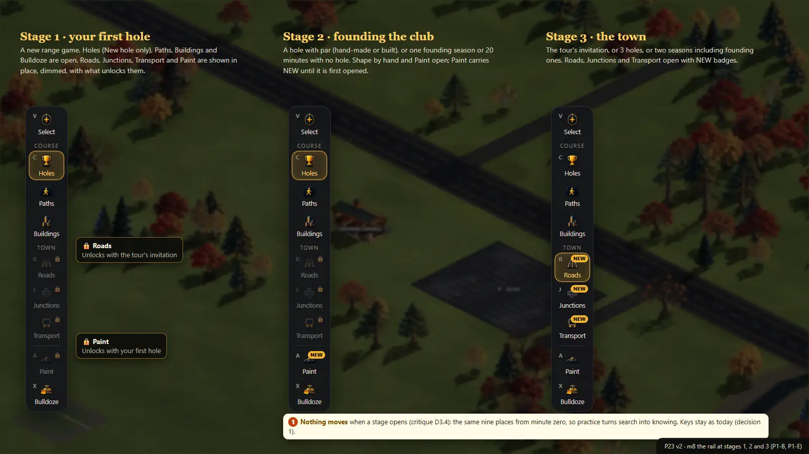

### 4.3 The Holes panel

**Anatomy (every tool panel follows it):** header (title, a one-line purpose, ↶ ↷ with the action named in the tooltip) → the primary
action, sticky at the top → the beginner controls → the tool's objects → **More options ▸**.

- **Stage 1 (minute zero):** the gold **New hole** pill and one line ("Click a tee, then a green: the whole hole is planned for you").
  Nothing else until a hole exists.
- **While New hole is open:** the pill area becomes the wizard card: the step (1 tee · 2 green · 3 shape), par, length, the price split
  (fairway, green, tee, rough and collars), Seed (default) or Sod with what it means, the checks with Fix buttons, and **Build · $X**
  at the top (T102's map pill stays by the green).
- **After hole 1:**
  - **Your holes:** a badge per hole that exists (1, 2 …) and a "+" badge (New hole ▾: Plan a hole · From a saved hole · An empty hole
    to paint by hand). Each badge has an icon as well as a colour (✓ ready, ◔ growing, ! needs attention). One status line under them:
    "Hole 1 · par 4 · 342 m · growing, ready Mar 1985".
  - **Shape by hand:** six swatches with marks (Fairway, Green, Tee, Rough, Bunker, Water; keys 1–6); sizes 1, 2 x 2, 3 x 3, 4 x 4
    ([ ]); **Brush | Run**; Erase (toggle; hold Alt for a moment); Protect other surfaces (on; hold Shift to paint over).
- **More options ▸ (labelled sections, remembered for the session):** Shapes (Box, Lasso, Stamps, round brush) · Look (mowing
  stripes; collars; and, with decision 3, **My looks**: each surface's saved look and the style editor, with the disc as its preview;
  until then the editor stays where it is today, under Show every tool now) · Planting (Seed or Sod, the same control as the wizard's) ·
  Hole (number, delete, saved holes) · Plants (today's plant brushes) · Ground (height).
- **Gone:** the 18-slot grid, the Build / Presets / Plants / Buildings tabs, the Method row, the help paragraph (now the hint pill), the
  separate hole box (now the status line, and the hole card in Phase 2).

### 4.4 New hole (T102, and what v2 adds)

1. **New hole** (the pill, or "+"). The tee follows the pointer; the other holes' corridors show faintly.
2. **Click the tee.** The camera eases out (400 ms at most, interrupted by any drag or wheel; a jump under reduced motion) to fit a 450 m
   circle round the tee in the free map beside the panel. Handles, labels and the corridor keep their screen size at any zoom.
3. **Click the green** (or, with decision 8 (b), click each bend and finish on the green with double-click, Enter or right-click). The
   camera fits the plan.
4. **Shape:** as T102 (drag the line or a "+" to bend, the amber handles for width, the tee and the green to move them, R turns the
   green, [ ] sizes it, right-click a bend to remove it). **Ctrl+Z and Ctrl+Y undo and redo these drags** while the wizard is open.
5. **Build** (the pill, the panel's Build, or Enter): one undo step, the build ripple, and the badge appears with "growing".
6. **Esc steps back one stage:** shape → the green step (the tee stays) → the tee step → out of New hole (the panel stays, nothing armed).

**What blocks Build and what only warns:**

| Check | Kind | What the player sees | Fix |
| --- | --- | --- | --- |
| Tee or green off your land | blocks | "The green is off your land" on the pill and in red at the green | drag it back |
| Tee or green on the driving range | blocks | "The driving range: golfers hit here" | drag it off |
| Not enough money | blocks | "Not enough money: $31,290 (you have $20,100)" | Sod → Seed, or a shorter hole |
| Nothing changed (editing) | blocks | "No changes" | – |
| Cells left out | warns | "340 m² left out: the driving range" (or a road, water, another hole), hatched on the ghost | Show me · Move the line |
| Too close to another hole | warns | "38 m from hole 3's line: golfers there are in range" (under 60 m) | Show me |
| A long walk | warns | "198 m walk from hole 1's green" (over 150 m) | – (a path after Build in Phase 3) |
| A road across the corridor | warns | "Crosses the county road: carts need a crossing" | – |
| Trees in the way | info | "12 trees cleared", the trees tinted in the ghost | – |

The checks run with the ghost (throttled as T102's panel is, 150 ms): two distances and a count, no new simulation.

- **Seed or Sod:** Seed is the default. Sod reads "Sod · ready now · $134,500: 4.3 times the price; nine holes like this would cost
  about $1.2M". A money line under the price: "Nine holes like this: about $282k · you have $600k" (m2's numbers).
- **Numbers:** the card says "New hole 3"; "Number ▾" offers another free number or "after 9".

### 4.5 Shape by hand: the brush, Run, and the current hole

- **The current hole is automatic and visible.** It is the hole you last built, edited or picked (a badge). A stroke that starts on a
  cell belonging to a hole paints for that hole; on unassigned ground it paints for the current hole. The hint pill shows it ("Fairway ·
  hole 2"). T102's data model (`brushHole`) is unchanged.
- **Brush:** click a cell, drag a gap-free run (T109), sizes 1 to 4 x 4.
- **Run (new, the street gesture):** click a start, click each bend, finish with double-click, Enter or right-click (decision 4); Shift
  keeps a leg straight. It lays a strip as wide as the size (1–4 cells) along the line, with the brush's ghost and price. For a fairway
  edge, a tee strip or a bunker lip.
- **Erase** takes the top surface under the footprint, whatever the swatch: a playing surface (green, tee, fairway, bunker, water)
  becomes rough, and rough becomes plain grass. Erasing refunds nothing (GOLF-PLAN 4.1); the hint says so.
- **Protect other surfaces** is on by default (a fairway stroke slides past a green). Holding Shift paints over (and draws a straight
  line from the last click, as in every other tool).

### 4.6 Readable grow-in

- Seeded ground starts as **sprouts**: the growth mask begins at a quarter grass instead of none (`course-fx` growMask), so a fairway reads
  as fairway from day one; full grass at the end of its grow-in, as today.
- The badge (◔), the status line, the hint and the hole card say "growing · ready Mar 1985".
- Sod shows its laid-turf look for a month, as today. The same look at every zoom (the fix in progress).

| Today, right after Build (17%) | v2 |
| --- | --- |
| 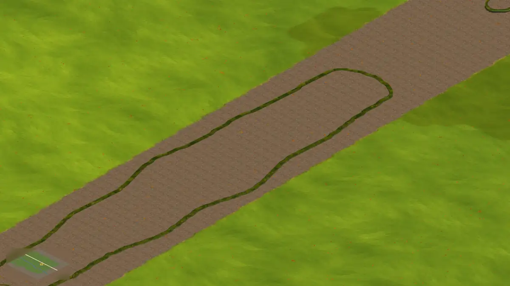 | 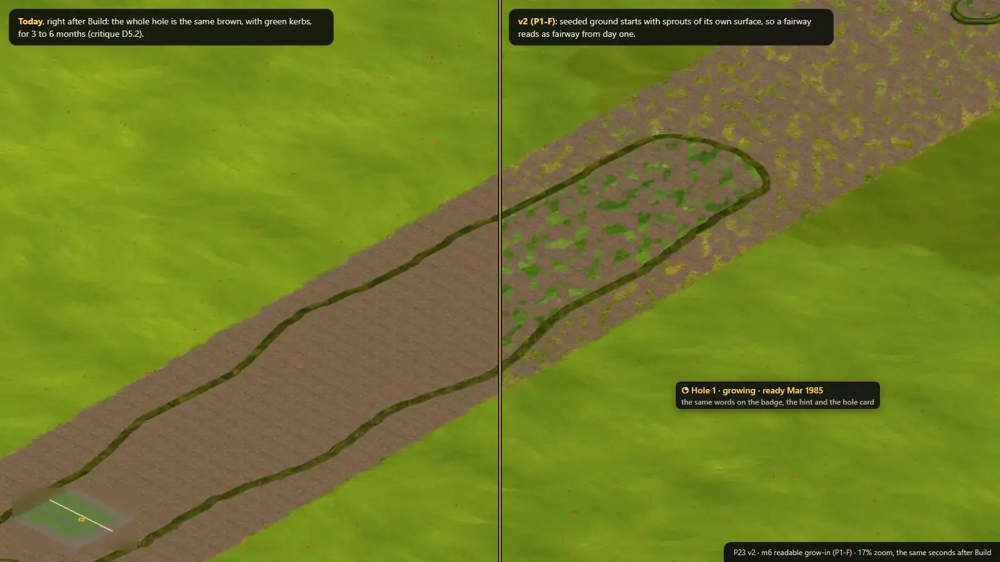 |

### 4.7 Paths (the streets)

- **Phase 1:** today's Paths & drives panel becomes the **Paths** rail item, with tabs Cart paths · Drives, a Draw · Upgrade switch, the
  cards with prices **a metre** ("$4 a metre"), the route box and **Build · $X** at the top. It is built exactly like a road: click,
  click each bend, finish with double-click, Enter or right-click (the owner's rule); right-drag pans.
- **Phase 2:** decision 7 (one Streets tool) and the keymap's single Upgrade.
- **Phase 3 (after T068 and T070):** path points on greens and tees (the plan's green edge nearest the next tee, the tee's back),
  "Path after Build" from the wizard, cart crossings instead of junctions, and a warning when a path crosses a fairway.

### 4.8 Buildings (the houses)

- **Phase 1:** the clubhouse moves from a tab to the **Buildings** rail item, as a card with its picture, price and "one only"; placement
  as today (its front snaps to a drive within 12 m, R turns it).
- **Phase 2:** when it is refused for want of a drive, "Draw a drive" opens Paths > Drives from the nearest road, and the clubhouse card
  comes back armed as soon as the drive is built.
- **Phase 3 (after T069b):** the ghost proposes its own drive to the nearest road or drive, with the price; one click builds both. The
  Event catalogue moves into a Tournament tab (rent or buy on each card); stand-in pictures say so (T114).

### 4.9 Feedback and previews

Words go in the hint pill; only Dragging, Refused and Money short also put them beside the disc.

| State | Look | Words |
| --- | --- | --- |
| Ready | the result's colour, translucent, with a crisp edge and its collar ring | the hint pill: "Fairway · hole 2 · $2 a m²" |
| Dragging | as ready, along the run | the run's total by the disc: "Fairway · 64 m² · $128" |
| No change | outline only | "already fairway" |
| Protected | dotted outline on the kept cells | "7 cells kept: the green stays (Shift paints over)" |
| Refused | red hatch and a ✕ at the pointer, only where it cannot go | the reason and one Fix: "The driving range: golfers hit here" |
| Erase | dashed edge, the colour you get back | "Erase · 16 m² back to rough · no refund" |
| Money short | the price in red | "Fairway · $3,200 · you have $2,100" |
| Snap | a green ring; a white link dot for buildings | – |

- **One meaning per line style:** dotted = kept, dashed = erase, gold dashed = your land's edge, solid gold = selected.
- **Labels near the pointer:** while a build tool is in hand, map labels and stand-in labels within 120 px of the pointer fade to 30%.
- **Words:** toasts and refusals use the player's words ("Hole 1 built: par 4, 342 m, $31,290", not "8 painted areas, 156 props").
- **Grids:** decision 5; nothing changes until the owner picks.

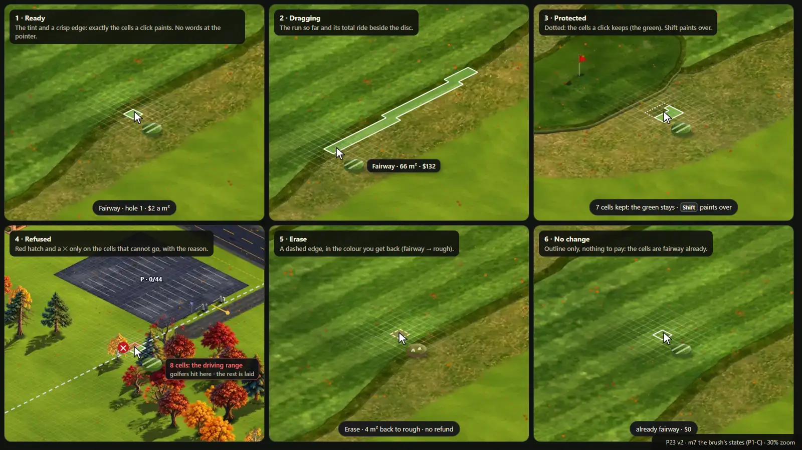

### 4.10 Keys, mouse and Esc

| Input | Does | Notes |
| --- | --- | --- |
| V, R, J, X, C, A, P, T, U, N, Y | Select, Roads, Junctions, Bulldoze, Holes, Paint, Car park, Toll, Bus, Upgrade, Downgrade | today's keys (decision 1); a key of a locked tool shows "Unlocks with …" and does nothing |
| WASD, arrows, right-drag, Space-drag | pan | recommended: a tap of A opens Paint, a hold pans |
| Wheel | zoom (trackpad setting: two-finger scroll pans, pinch zooms) | |
| 1–6 | surfaces in Holes; path kinds in Paths; road classes only when Roads is unlocked | today 1–6 arm a hidden Roads tool |
| [ ] | size (brush, Run, the green in the wizard) | |
| R | turn (the green, a building) | |
| Shift (hold) | straight line; in Holes also paint over | |
| Alt (hold) | erase for a moment (the Erase toggle is the main control: Alt is risky on Windows Chrome and Linux desktops) | |
| Enter, double-click, right-click | build or finish what is being drawn (roads, paths, Run; New hole too with decision 8 b) | the owner's rule; Enter already builds in T102's shape step |
| Right-click on a handle or corner | remove that bend or corner | as T102 and Paint today |
| Ctrl+Z, Ctrl+Y | undo and redo (in the wizard: its drags first) | |
| Esc | close the top menu or card → step back one stage → drop what is in hand → Select | today Esc flips Brush and Shape |
| G, F, B, H, Space, , . | map grid, traffic, bottlenecks, skip to rush, pause, speed | today's |

### 4.11 Accessibility and devices

- **Text:** 13 px for body text and controls, 12 px at least for secondary lines (hints, sub-labels), 11 px only for keycaps and
  small-caps headings (today: 10–12 px everywhere). Settings > UI scale: 90, 100, 125%.
- **Colour never alone:** badges have icons (✓ ◔ ! 🔒); refused cells are hatched with a ✕; surfaces have marks on the swatches and the
  chip; the palette is checked with deuteranopia, protanopia and tritanopia simulation.
- **Keyboard:** visible focus rings (2 px gold, offset 2 px), a sensible Tab order through each panel, Enter and Space press, Esc closes
  the top menu or card first.
- **Motion:** only transform and opacity; press 100–150 ms, panels 180–250 ms, camera eases 400 ms at most and interruptible; the chip
  catches up at once on a fast move; reduced motion: fades only, no breathing, no particles, camera jumps.
- **1366 x 768:** the primary action at the top of every panel. The top bar fits one row once All tools moves to Settings (P1-B):
  today it needs 1,346 px of the 1,342 px row and wraps, which pushes the rail down to y ≈ 150. Rail items are 52 px when the window is
  under 800 px tall, so the nine items clear the minimap. A compact panel (icon rail 56 px, panel 300 px) is a Phase 2 option. The main
  mockups are rendered at 1366 too (`v2-m1-start-1366.webp`, `v2-m2-new-hole-1366.webp`, `v2-m3-brush-1366.webp`).
- **Trackpad and touch:** Settings > Controls > Trackpad (two-finger scroll pans, pinch zooms); every held key has an on-screen toggle;
  handles are 24 px on coarse pointers; touch play (tap to preview, tap again or Build to commit) is designed for, shipped later.
- **Empty states:** Select on empty grass shows "Click a hole, a path or a building"; Buildings with nothing affordable says what is
  missing; a locked tool's panel says how it unlocks.

### 4.12 The first ten minutes (an honest walk, with Phase 1 and 2 in)

| When | The player does | Actions | What could go wrong | How v2 prevents it |
| --- | --- | --- | --- | --- |
| 0–5 s | Reads the welcome card, clicks Build your first hole | 1 | the map is black while the ground bakes | the card waits for the ground (Phase 2, with T095) |
| 5 s | The camera moves onto the course land; New hole is armed; a ring marks a good tee | 0 | a tee on the range plot | the range plot is marked; the ring is on the land |
| 10 s | Clicks the tee | 1 | the green would be off screen | the camera eases out to fit |
| 15 s | Clicks the green | 1 | – | – |
| 20 s | Drags a bend or a width (optional) | 0–2 | Ctrl+Z undoes hole 1 | the wizard's own history |
| 30 s | Builds | 1 | cells silently left out | the warning, hatch and count |
| 35 s | Looks at hole 1 | 0 | brown dirt | sprouts and "growing · ready Mar 1985" |
| 1–3 min | Buildings → Clubhouse → places it near the range's drive | 3 | no drive near the spot | the stopgap (Phase 2), the proposed drive (Phase 3) |
| 3–10 min | Holes 2–9: New hole, tee, green, Build (x8) | 32–40 | too close, a long walk, the wrong number | the warnings and the number on the card |

About 40–50 actions for a nine and a clubhouse, and every failure point above has a design answer; paths between the holes wait for
Phase 3.

---

## 5. Mockups (re-shot on main after #205)

Sources in `docs/plans/P23-ux/mockups/` (`v2-*.html`; `render.mjs` renders them; `capture-v2.mjs` re-shoots the backgrounds from a dev
server). Today's screens (`t*.webp`) come from the same capture runs.

| v2 mockup | Shows | Today beside it |
| --- | --- | --- |
| `v2-m1-start.webp` (+ `-1366`) | minute zero: welcome card, the rail with locked tools in place, the Holes panel as one button, the land lit and the range plot marked | `t01-start-today.webp` |
| `v2-m2-new-hole.webp` (+ `-1366`) | New hole in the shape step over the real T102 ghost: the wizard card on top, checks with Fix, Seed default and Sod's cost, the money line, the camera framed | `t02-wizard-today.webp`, `t04-wizard-1366-today.webp` |
| `v2-m3-brush.webp` (+ `-1366`) | after hole 1: badges with icons, Shape by hand with marked swatches, Brush and Run, the footprint and the disc alone, the hint pill naming the surface and hole | `t06-brush-today.webp` |
| `v2-m4-more.webp` | More options open in sections, with My looks' editor and its live chip preview | – |
| `v2-m5-paths.webp` | Paths as streets: Build on top, tabs, cards a metre, a cart path drawn like a road along hole 1, right-click or double-click to build | – |
| `v2-m6-growin.webp` | readable grow-in: sprouts and "growing · ready" right after Build | `t05-growin-today.webp` |
| `v2-m7-states.webp` | the brush's states: ready, dragging, protected, refused, erase, no change | – |
| `v2-m8-rail-stages.webp` | the rail at stages 1, 2 and 3, locked tools in place | – |
| `v2-m9-grid-options.webp` | decision 5's three half-grid options on the same view | – |
| `v2-m0-model.webp` | the model: what lives where, Phase 1 against later | – |

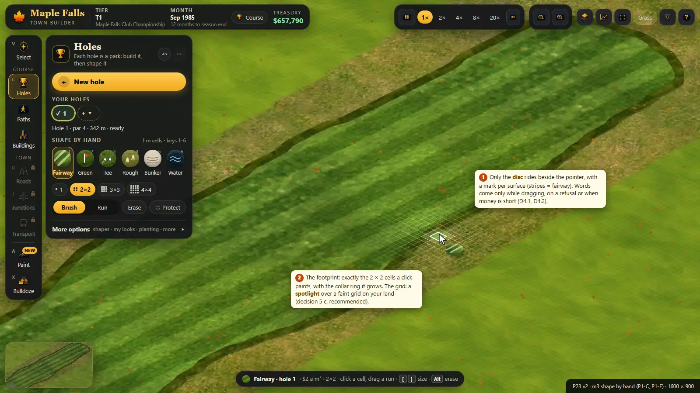
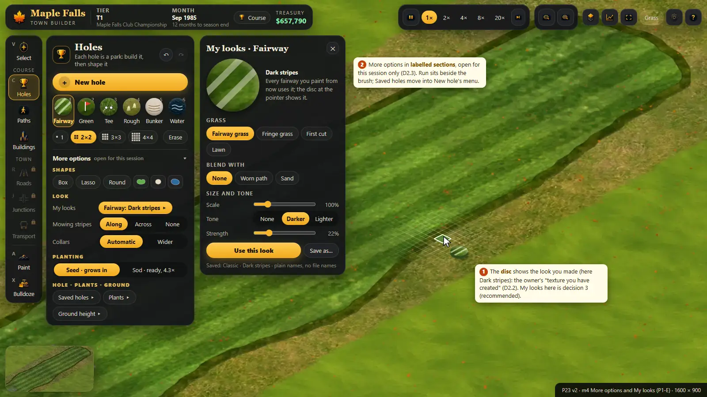
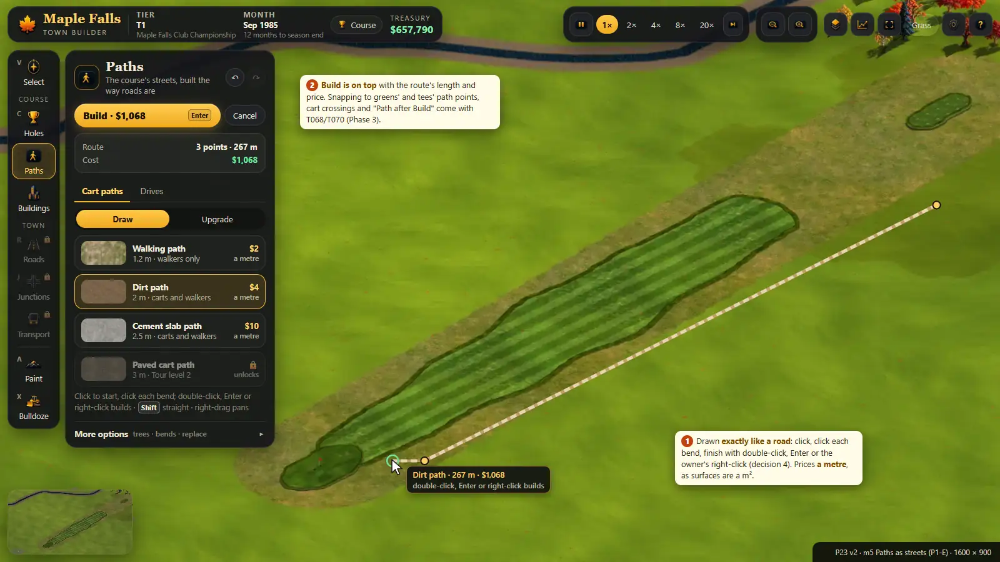
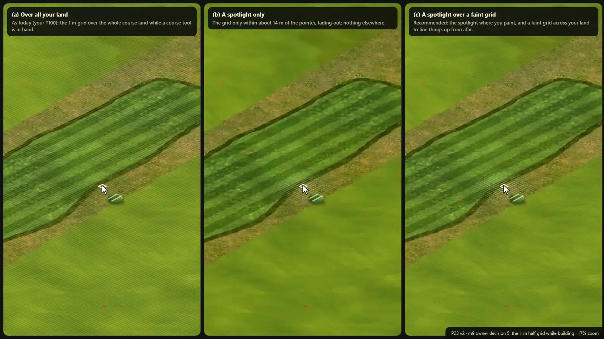

---

## 6. Tickets

U-numbers are placeholders; the lead gives T-numbers when posting. **G** changes gameplay or rules, **L** is layout and words. Every
ticket's checks include `npm run typecheck`, its own tests, and screenshots at 1600 x 900 and 1366 x 768 compared with the mockup named;
the lead runs the full suite and the bench, one heavy run at a time.

### 6.1 Phase 1: the 80/20 (no owner decision, no unposted ticket)

**Wave A: start now, in parallel.**

- **P1-A Modes never steal a click; Esc closes menus first** (G, small).
  - **Files:** `src/game/engine.ts` (pointerDown, setTool, keyDown), `src/App.tsx` (the gear menu, the right-hand panels),
    `src/game/paint-tool.ts` (key(): the brush's Esc only).
  - **Behaviour:** the Grass panel, Land, Event and Holes switches no longer take clicks from a build tool: opening one switches to
    Select, and picking any build tool closes it. Esc closes the topmost menu or card (gear, Event, Grass, Course stats) before it
    reaches the tool. In the brush, Esc drops what is in hand (no Brush–Shape flip), then a second Esc leaves to Select. The Land chip is
    hidden in range starts until the land fix is in.
  - **Checks:** tests that `setTool('course')` clears `grassPanel`, `landMode`, `holesTool`, `eventTool`, and the Esc ladder; a browser
    check that the brush paints with the Grass panel just closed.
  - **Depends on:** nothing. Small overlap with #206 in App.tsx (the gear menu): rebase.
- **P1-B Unlocks from the course, never stranded** (G, small, pure).
  - **Files:** `src/game/ext/progressive-ui/index.ts`, `progress.ts`, `guide.ts`; `src/game/engine.ts` (playerProgressFacts passes holes
    with par and `seasonsDone()`); `src/App.tsx` (the All tools chip becomes a gear-menu checkbox); `tests/ext-progressive-ui*.test.ts`.
  - **Behaviour:** the stage table of 4.2; NEW badges (seen ids in `golf.progress`); the state lists both visible and locked tools (for
    the in-place rail); the stuck-player fallback; no 10-minute rule; All tools becomes Settings > Show every tool now (which also lets
    the top bar fit one row at 1366 px).
  - **Checks:** table tests for every row, a founding-season player with no hole reaching stage 2, old saves with every tool.
  - **Depends on:** nothing; a few lines of App.tsx's gear menu overlap P1-A (rebase whichever lands second).
- **P1-C The chip says what it lays** (L, small; follows T110).
  - **Files:** `src/game/ext/course-cursor/index.ts`, `tex.ts`; `src/game/engine.ts` (the toasts' words); `src/App.tsx` (the hint pill
    text for the Course tool).
  - **Behaviour:** a mark per surface on the disc; no steady label, only the drag total, a refusal with its reason, or money short;
    the "no change" state; refused cells hatched with a ✕; the hint pill names the surface, the hole and the price a m².
  - **Checks:** `tests/ext-course-cursor.test.ts` (labels by state, marks by surface); dpr 1 and 2 screenshots at 17% and 30%; a
    colour-blindness simulation of the six discs.
  - **Depends on:** the range-plot message fix (it touches the same reason strings).

**Wave B: when wave A's files are in.**

- **P1-D New hole, finished** (G, medium; a T102 follow-up).
  - **Files:** `src/game/paint-tool.ts` (plan mode: planKey, planDown), `src/game/ext/hole-wizard/index.ts` (history, checks, numbers),
    `ext/hole-wizard/draw.ts` (the warning hatch, constant-size handles), `src/ui/course/HoleWizard.tsx`, `src/game/engine.ts` (the camera
    fit), `tests/ext-hole-wizard.test.ts`.
  - **Behaviour:** a new range game opens Holes with New hole armed; the camera framing of 4.4; the wizard's own undo; the Esc ladder; the
    check table (blocks, warnings, Fix); Seed default and Sod's season cost; the money line; the number picker.
  - **Checks:** tests (history, every check row, Esc stages, numbers); a browser walk: tee, green, a drag, Ctrl+Z, Build, at 1600 and 1366.
  - **Depends on:** P1-A (engine.ts and paint-tool.ts key handling).
- **P1-E The Holes panel and the Course group on the rail** (L, medium; replaces T103's layout, keeps its motion).
  - **Files:** `src/App.tsx` (GROUPS: Holes, Paths, Buildings as rail items via `uiTool`, locked tools in place, NEW badges, the
    status line), `src/ui/course/CoursePanel.tsx`, `HoleStrip.tsx` (badges with icons), `HoleWizard.tsx` (on top), `src/index.css` (13 px,
    focus rings, pills, marked swatches), `src/PaintPanel.tsx` (plain texture names in StyleEditor; it stays where it is until
    decision 3).
  - **Behaviour:** sections 4.2 and 4.3; keys unchanged; rail items 52 px under 800 px tall; text sizes of 4.11.
  - **Checks:** screenshots against v2-m1, m3, m4, m8 at both sizes (the top bar on one row at 1366 x 768); a test that stage 1 renders
    New hole only.
  - **Depends on:** P1-A (App.tsx), P1-B (the visible and locked lists).
- **P1-F Readable grow-in** (G, small).
  - **Files:** `src/game/ext/course-fx/index.ts` (growMask starts at a quarter grass), its test, `src/game/engine.ts` (re-send growing
    chunks once on load so old saves pick it up).
  - **Behaviour:** section 4.6.
  - **Checks:** the course-fx tests; screenshots of a hole just built at 8, 11, 17 and 30%.
  - **Depends on:** the grow-in-across-zooms fix in progress (same code path).
- **P1-G Run: a road-like strip of cells** (G, medium).
  - **Files:** `src/game/paint-tool.ts` (a `run` mode on the course grid), `src/game/ext/course-cursor/index.ts` (the run's footprint),
    `src/ui/course/CoursePanel.tsx` (Brush | Run), tests.
  - **Behaviour:** section 4.5; one undo step per run; price as the brush.
  - **Checks:** tests (a straight run of 40 m by 2 cells lays 80 cells; a bend joins without gaps; Shift keeps a leg straight); a bench
    case (a 200 m run under 4 ms main thread).
  - **Depends on:** P1-C (course-cursor), P1-E (the panel row).

### 6.2 Phase 2: after Phase 1, T095 and the owner's answers

- **P2-1 The owner's decisions applied:** road-style New hole (8b), the chosen half grid (5), one Streets tool (7a), the A tap and hold
  (1), My looks' place (3).
- **P2-2 The top bar and the season card** (L): the season chip with the founding checklist and Fix buttons; Course stats move into its
  card; the duplicate round pill goes and its founding sentence is fixed. Files: App.tsx, a new `ui/golf/SeasonCard.tsx`.
- **P2-3 The welcome card and guide anchors** (with T095 and P06): `data-guide` anchors on controls, engine events (hole built,
  clubhouse placed), the card waiting for the ground.
- **P2-4 The hole card** (L): Select a hole: par, lengths, grow-in, areas, checks with Fix, pin and marker drags (no re-plan), Edit hole,
  Delete; renumber by dragging badges. Existing data only.
- **P2-5 Greenkeeping** (G): today's Grass panel as a tool on the rail (unlocks with the first grown hole); Overseed and Re-turf names.
- **P2-6 Land for sale** (G, after the land fix): an overlay; a block click opens a card with Buy; the brush's refusal offers it.
- **P2-7 Accessibility and devices** (L): UI scale, focus rings everywhere, colour checks, the compact panel, the trackpad setting,
  24 px handles on coarse pointers, styled tooltips with keys and reasons.
- **P2-8 The keymap** (behaviour): 1–6 and locked tools, the A tap and hold (if decided), Help > Keys.
- **P2-9 The clubhouse stopgap**: "Draw a drive", then back to the clubhouse armed.
- **P2-10 Ghost extras** (G): trees-cleared tint and count, the collar ring in the footprint, label fading near the pointer.

### 6.3 Phase 3: after T068, T069b and T070

- **P3-1 Streets features:** path points on greens and tees, "Path after Build", cart crossings, the fairway-crossing warning.
- **P3-2 Buildings:** structures snap to drives and paths (T069b), the proposed drive, the Tournament tab with rent or buy.

### 6.4 Phase 4: spikes and later

- **Undo journal** (spike): one chronological history across tools, refund rules, dependencies.
- **Blueprint mode:** lay out holes for free, see the total and the land, build as money allows; blueprint holes block nothing and are
  drawn in a dashed blue, and they are saved.
- **The course's homes** (decision 9), **moving a whole hole**, **touch play**, a click-through prototype of New hole and the brush.

**Collisions to watch:** P1-A and P1-E both touch App.tsx (land P1-A first); P1-D and P1-G both touch paint-tool.ts (P1-D first); #206
touches App.tsx's gear menu; the three bug fixes in progress touch the range-plot message (P1-C) and the grow-in path (P1-F).

---

## 7. Risks and open questions (v2's own doubts)

1. **Sprouts from day one** are friendlier than bare dirt but less literal: a hole seeded today shows a quarter grass. If the owner
   wants bare earth first, keep the sprouts only while the Holes tool is in hand.
2. **Road-style holes (decision 8 b)** turn the simplest straight hole into "click the tee, double-click the green". The hint must say
   so, and a second click on the same spot should finish.
3. **The automatic current hole** can still surprise: a stroke that starts on hole 2's rough paints for hole 2. The hint pill shows the
   hole before the click; is that enough?
4. **Locked tools shown in place** add four dimmed items at minute zero; I judge the fixed positions worth it.
5. **Camera framing** moves the view without the player asking; it must be short, interruptible and never fight a drag.
6. **Run** may overlap with Box and Lasso; if players never use it, fold it back.
7. **Phase 1's App.tsx work** (P1-A, P1-E) runs next to #206; small but real merge work for the lead.

---

## 8. Appendix: research (from v1, kept)

**Principles, and the rule each gives us:** progressive disclosure (two levels, a labelled way in), Hick's law (few unfamiliar choices
for beginners, a fixed order), Fitts's law (big labelled targets, previews beside the pointer, never on it), recognition over recall
(icons with words, swatches of the real look), direct manipulation (handles on the map, live re-plans), feedforward (the ghost and price
before the click), error prevention and undo (constrain, warn with a Fix, undo every step), consistency (one gesture per meaning),
modes (one tool in hand, held keys for alternates, nothing steals clicks), onboarding by doing (guided steps at the moment of need),
motion (short, transform and opacity, reduced motion respected), grouping and plain words.

**Games:** SimGolf (the two-click hole), PGA Tour 2K's designer (tee, landing, green; handles later; auto content experts strip out),
Two Point (a checklist that keeps Build disabled), Cities: Skylines I and II (two-click roads, previews of what a road creates,
milestone unlocks, the cost of no undo), Planet Coaster and Planet Zoo (a tool per job, brushes, habitats with validity rules; tabs
inside tabs), Parkitect (grid paths, risky results opt-in, no undo), RollerCoaster Tycoon (prices first, refusals with a reason),
Townscaper and Islanders (one action, a good result, the score before you place), Anno (snap and face the road, roads by a fixed rule),
Tiny Glade and Manor Lords (things that decorate themselves, the link dot).

**Sources:**
[Progressive Disclosure (NN/g)](https://www.nngroup.com/articles/progressive-disclosure/) ·
[Hick's Law (Laws of UX)](https://lawsofux.com/hicks-law/) ·
[A predictive model of menu performance (Cockburn et al., CHI 2007)](https://doi.org/10.1145/1240624.1240723) ·
[Fitts's Law (NN/g)](https://www.nngroup.com/articles/fitts-law/) ·
[Shift (Vogel and Baudisch, CHI 2007)](https://www.patrickbaudisch.com/projects/shift/index.html) ·
[Recognition and recall (NN/g)](https://www.nngroup.com/articles/recognition-and-recall/) ·
[Direct manipulation (NN/g)](https://www.nngroup.com/articles/direct-manipulation/) ·
[Feedforward (Vermeulen et al., CHI 2013)](https://doi.org/10.1145/2470654.2466255) ·
[Preventing user errors (NN/g)](https://www.nngroup.com/articles/slips/) ·
[User control and freedom (NN/g)](https://www.nngroup.com/articles/user-control-and-freedom/) ·
[Modes in user interfaces (NN/g)](https://www.nngroup.com/articles/modes/) ·
[Mode errors and sensory feedback (Sellen, Kurtenbach, Buxton 1992)](https://billbuxton.com/ModeErrors.html) ·
[Onboarding tutorials vs contextual help (NN/g)](https://www.nngroup.com/articles/onboarding-tutorials/) ·
[The impact of tutorials on games of varying complexity (Andersen et al., CHI 2012)](https://grail.cs.washington.edu/projects/game-abtesting/chi2012/) ·
[prefers-reduced-motion (MDN)](https://developer.mozilla.org/en-US/docs/Web/CSS/@media/prefers-reduced-motion) ·
[WCAG 2.2 SC 2.3.3](https://www.w3.org/WAI/WCAG22/Understanding/animation-from-interactions.html) ·
[Animation duration (NN/g)](https://www.nngroup.com/articles/animation-duration/) ·
[PGA TOUR 2K25 course designer (2K)](https://pgatour.2k.com/2k25/up-your-game/course-designer/) ·
[Two Point room templates](https://community.twopointcounty.com/two-point-studios/two-point-hospital/blogs/9-room-templates-deep-dive) ·
[Cities: Skylines II road tools (Paradox)](https://forum.paradoxplaza.com/forum/developer-diary/development-diary-1-road-tools.1590300/) ·
[Milestones (CS wiki)](https://skylines.paradoxwikis.com/Milestones) ·
[Planet Coaster 2: building your park](https://www.planetcoaster.com/player-guides/building-your-park) ·
[Parkitect devlog 130](https://www.texelraptor.com/blog/devlog-update-130) ·
[OpenRCT2 footpaths](https://docs.openrct2.io/en/latest/playing/footpath/index.html) ·
[How Townscaper works (Game Developer)](https://gamedeveloper.com/blogs/how-townscaper-works-a-story-four-games-in-the-making) ·
[Anno 117: roads and building in the grid](https://www.anno-union.com/?p=20685) ·
[Manor Lords roads (Game8)](https://game8.co/games/Manor-Lords/archives/452353).
v1's full source list is in `P23-ux/v1/P23-UX-v1.md`.
