# P23: The course town, a friendly builder (UX plan v1)

Status: **v1 for critique** (2026-10-25). Research, audit and plan only: no game code changed. Written on `plan/P23-ux` from main at
`223849a` (after #196: the 2 m map grid, the 1 m half grid, T108's cursor chip, T109's 1 m cells). A critic attacks this v1 next, then v2.

The owner (2026-10-25, verbatim in the brief): "the Paiting and course stuff UIX is still TERRIBLE ... IT NEED TO BE USER FRIENDLY ...
Seperate things and group them together logically and show the user beginner shit and hide advance stuff in collapsable menus. Think of
the entire game as building the course and the pathways as a town you are building. The course will have its own houses later and the
holes are like parks. All connected with litter cart paths and streets." And on T109: "there are 2 grids. 1 is the town grid. this is the
size of 1 piece of road and then theres a mini grid which is 1 town grid square split into 4. that is the size we work on when building".

## 0. The plan on one screen

- **One mental model: the course is a town you build.** Holes are its parks, cart paths and drives are its streets, the clubhouse, pro
  shop and later the course's homes are its houses. Every build tool belongs to one of those, and everything connects by paths.
- **One rail, grouped by what you build:** Select · *Course:* **Holes**, **Paths**, **Buildings**, **Landscape** · *Town:* Roads,
  Transport · Remove. Reports, money and views leave the rail and sit in the top bar. Nothing in the top bar changes what a click does.
- **Each tool has one panel with the same anatomy:** title and purpose, undo, one gold primary action, the few beginner controls, its
  objects (your holes), and one collapsed **More options** drawer. Never a third level.
- **Holes are built as parks:** **New hole** (click a tee, click a green, drag handles, Build: 4 clicks) roughs in the whole hole with
  real widths, par, length and price. **Shape by hand** in 1 m cells (T109) refines it. Cells join the hole they are painted in, so
  there is no "current hole" to pick first.
- **The preview is always the truth:** the ghost shows exactly what a click builds and what it costs; red appears only where it cannot
  go, with the reason and a Fix. T108's surface chip sits beside the pointer and names the action.
- **No hidden modes:** Land, Grass, Event and Holes stop hijacking clicks; Esc always steps out; temporary alternates are held keys
  (Alt erases, Shift paints over).
- **The first minute is three things:** a welcome card, New hole, a playable hole 1. Tools appear as the course earns them (a NEW
  badge), not by stroke counts or a 10-minute timer.
- **20 draft tickets,** three of them quick fixes for today (modes, Esc, the flag drawn as a house). Section 11.

| | |
| --- | --- |
| 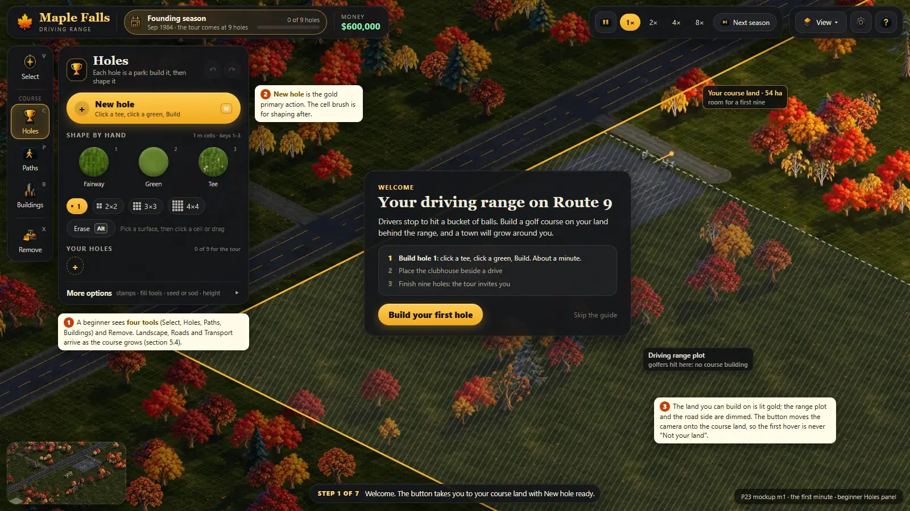 | 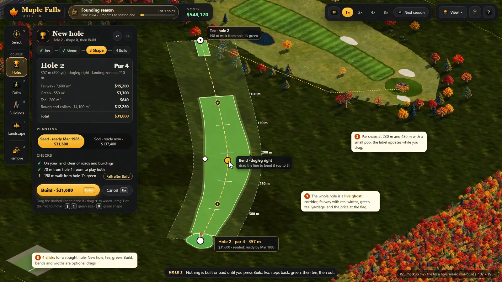 |
| m1 · the first minute, beginner Holes panel | m2 · New hole mid-build |
| 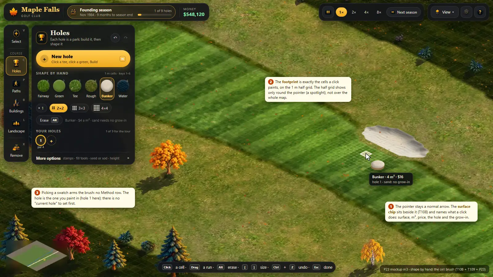 | 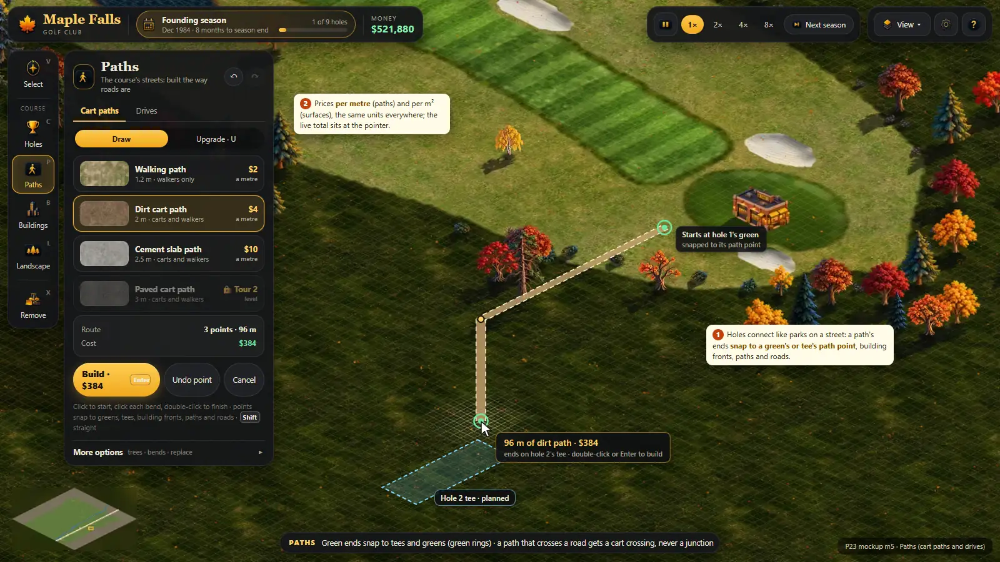 |
| m3 · shape by hand: the cell brush with the chip | m5 · Paths, drawn like roads |

---

## 1. Inputs: what is already decided or on main

- **On main (#196):** T100 (a subtle 2 m map grid, toggle G; the 1 m course half grid while a course tool is active; cart paths and
  drives snap to the half grid), T108 (the pointer stays a pointer; a 40 px 3D surface chip sits lower right of it; the footprint is a
  clean translucent tint of exactly the cells a click paints; muted red with a reason where it skips), T109 (the building unit is one
  1 m cell; sizes 1, 2 x 2, 3 x 3, 4 x 4; the round brush and the big pieces, now **Stamps**, sit under Advanced; the Course tool opens on
  the brush; prices per cell, live).
- **Open tickets this plan builds on:** T101 (cell brush ghost and map animation), **T102 (the New hole wizard and plan handles)**,
  T103 (the course panel, rounded and animated), T104 (stamps; retire Pieces and Shape for course surfaces), T105 (P19 hooks), T095
  (P22's first minute), T069b (buildings snap to drives and paths), T068/T070 (the path network).
- **Plans:** P21 (the 1 m course grid, droplet outlines, the wizard's defaults: par-4 fairway 30 / 40 / 28 / 22 m, green 550 m²,
  60 m corridors), P19 (course paths and drives as a miniature road catalogue; buildings snap to them), P22 (the start: one road, the
  driving range, founding seasons, the welcome card, the 7-step guide), P20 (lot presets: the town's houses; not a build tool).
- **The owner's standing rules used here:** one sun at the upper right; nothing mirrored; no manual "rebuild ground" step; the lead's
  recommendation is the decision for design questions (LEAD.md 5).

## 2. Research

Three research passes (principles; city and park builders; golf and cozy builders) opened the sources listed in section 12. Below is
what we take. "(unverified)" marks a claim seen only in a search snippet.

### 2.1 Principles and the rule each gives us

| Principle | What the evidence says | Our rule |
| --- | --- | --- |
| Progressive disclosure | Show what most people need; keep the rest one visible, labelled click away; past two levels usability drops (Nielsen). Hidden navigation was used 27% of the time against 48% visible (NN/g). | Two levels per tool: the panel, and one **More options** drawer with a label that says what is inside. Never hide a beginner tool in a drawer. |
| Hick's law | Choice time grows with the log of the options for practised users; novices scan unfamiliar lists one by one, which is linear (Cockburn et al. 2007; Laws of UX). | Few options at once for beginners; a fixed order that never reshuffles, so practice turns search into knowing. |
| Fitts's law | Time grows with distance and shrinks with size; the pixel under the pointer is the fastest target (Tognazzini). Hidden targets are the problem: Shift (Vogel and Baudisch) moved the occluded area to an offset callout. | Big labelled rail buttons; the preview chip sits offset beside the pointer and never covers the cells being painted (T108). |
| Recognition over recall | Seeing beats remembering; few icons are universal, so labels stay visible (NN/g). | Every tool has an icon and a word; every surface is a swatch of its real photo with its name; keys printed on the buttons. |
| Direct manipulation | Visible objects, physical actions, rapid, incremental, reversible operations with immediate results (Shneiderman, via NN/g). | Grab the tee, the green, the bend and the width on the map; the hole re-plans while you drag; each drag is one undo step. |
| Feedforward and previews | Feedforward tells you what an action will do before you act (Vermeulen et al., CHI 2013); NN/g: preview before wide consequences. | Every tool shows a ghost of the result with its price before the click. |
| Errors and undo | Slips (right goal, wrong action) and mistakes (wrong model) need different cures: constraints and defaults for slips, previews and undo for mistakes; easy recovery invites exploration (NN/g). | Snap and constrain instead of warning; Build stays disabled with a reason until valid; Ctrl+Z everywhere, with the action named. |
| Consistency | One word, icon and gesture per meaning, across the game (NN/g). | Left click builds, right click or Esc backs out, Alt erases, Shift overrides, Enter commits, in every tool. |
| Modes | A mode makes the same input do different things; mode errors happen when the mode is invisible or forgotten (NN/g; Raskin). Held modes cause fewer mode errors than latched ones (Sellen, Kurtenbach and Buxton 1992). | One active tool, shown twice (rail highlight and the pointer's chip). Temporary alternates are held keys. Nothing outside the active tool takes over clicks. |
| Onboarding by doing | Front-loaded tutorials interrupt and are forgotten; help at the moment of need works (NN/g); playing is learning (Hodent). Tutorials paid off only in the most complex of three games (Andersen et al., CHI 2012). | A welcome card and New hole; tools unlock when the course needs them, each with a one-line tip; no wall of text. |
| Motion | `prefers-reduced-motion` and WCAG 2.3.3: motion from interaction must be possible to turn off; most UI motion 100–500 ms, shorter when frequent (NN/g); animate only transform and opacity (web.dev). | 100–150 ms press feedback, 180–250 ms panels, a springy ease; nothing on every brush dab beyond a light squash; reduced motion gives fades. |
| Grouping and words | Proximity and common region group things (NN/g); use the player's words, not internal jargon. | Group labels on the rail (Course, Town); plain names (Erase, not Rub out; Paths, not route). |

### 2.2 Games: what makes building feel easy, what to steal, what to avoid

- **SimGolf:** click a tee, then a green, and par and the route appear; you paint around it after; criticism comes from golfers'
  bubbles. *Steal:* the two-click hole and the route line; golfer feedback later. *Avoid:* no tutorial, a camera too far to read.
- **PGA Tour 2K designer:** Create Hole is tee, landing point, green; surfaces by brush stamps or splines; rough added automatically.
  *Steal:* big moves first, handles you drag later, live widths. *Avoid:* auto content experts strip out (guides tell you to set the
  generator to zero), two ways to make one surface with no guidance, a hole that starts as a bare pin.
- **Two Point Hospital and Campus:** pick a room, drag it, place the required items (marked), the tick turns green only when valid;
  templates were the studio's most requested feature. *Steal:* the hole as a room: a checklist that keeps Build disabled until the hole
  works. *Avoid:* edits that empty a room; requirements hidden in tooltips.
- **Cities: Skylines I and II:** a road is two clicks, the zoning grid shows the blocks it creates before you commit, crossings make
  junctions themselves, upgrade in place, the related info view opens with its tool, menus unlock by milestone. *Avoid:* snapping to
  sources you cannot see (grids drift); vague refusals ("Overlapping items"); no undo (players asked for Move It and refunds).
- **Planet Coaster 2 and Planet Zoo:** a tool per job (line, draw, stamp), brushes for bulk edits, undo that works while paused, a
  habitat is one object with explicit validity rules. *Avoid:* reviewers called the UI tabs inside tabs, full-screen pickers and
  confirm clicks for everything; a review found the path tool fights you, and notifications say what is wrong but not why.
- **Parkitect:** paths on a grid, the cursor stops at a blocked tile, risky results are opt-in with a modifier, one always-on snap set,
  the pipette jumps the menu to the item. *Avoid:* no undo (the developer: undo doubles the code of every action), deletes that hit
  neighbours.
- **RollerCoaster Tycoon / OpenRCT2:** every tool shows its price first; refusals are a headline plus the reason ("Land not owned by
  park!", "Not enough cash - requires $X"). *Avoid:* dozens of tabs with no search; two modes in one path window.
- **Townscaper and Islanders:** one action, an instant good result, no way to fail; Islanders previews the score before you place.
  Islanders shipped without undo and added it after complaints. *Steal:* strokes whose edges resolve themselves (our collars), the
  score at the pointer.
- **Anno 1800 and 117:** quick-build keys, blueprint mode, ranges shown while placing, buildings snap and turn to face the nearest
  road with a visible link, roads routed by a fixed rule between two clicks (guessing intent from the mouse "was not reliable
  enough"). *Avoid:* deep radial nesting on console and mixed horizontal and vertical tabs (reviewers stayed lost).
- **Tiny Glade and Manor Lords:** draw, and it builds and decorates itself; a building's connection dot turns white over a road; plots
  follow the road's edge. *Steal:* the link dot, handles on the object, first-use hints only.

**The ten patterns we take:** (1) big moves first, details after (the wizard, then cells); (2) the result and price before the click;
(3) red only where it cannot go, with a named reason and a Fix; (4) things that touch join themselves (droplets, collars, path joins);
(5) handles on the object, not sliders; (6) snap and turn to the nearest path, with a link marker; (7) a validity checklist that keeps
Build disabled; (8) undo for every action; (9) two menu levels at most, a fixed order, labels always visible; (10) unlocks by progress,
taught by one line at the moment they appear.

## 3. Audit of today (main at `223849a`, after #196)

**Method.** Vite on 127.0.0.1:5404 from this worktree, a new range game with production-like flags (`?unlock=0&money=0&grow=1`),
headless Chrome at 1600 x 900 (and dpr 2 for the cursor), scripted clicks and drags on the owned land. About 50 screenshots in
`E:/ClaudeTemp/ux/audit2/` (current) and `E:/ClaudeTemp/ux/audit/` (before #196); the referenced ones are in `docs/plans/P23-ux/`.
I also read `src/App.tsx`, `src/ui/**`, `src/PaintPanel.tsx`, `src/game/paint-tool.ts`, the engine's input and tool code and
`ext/progressive-ui`.

**What #196 fixed** (the owner's cursor complaint): the OS pointer is back; the pixelated wireframe prism is gone (before: `a12`); the
chip sits beside the pointer and is crisp at dpr 2 (`a13`); the footprint is a clean tint on the half grid (`a03`, `a04`); the default is
the 1-cell brush, and the massive pieces are under Advanced. The direction is right; the rest of the experience is not.

| Start (`a01`) | The stage-1 Course panel (`a02`) |
| --- | --- |
| 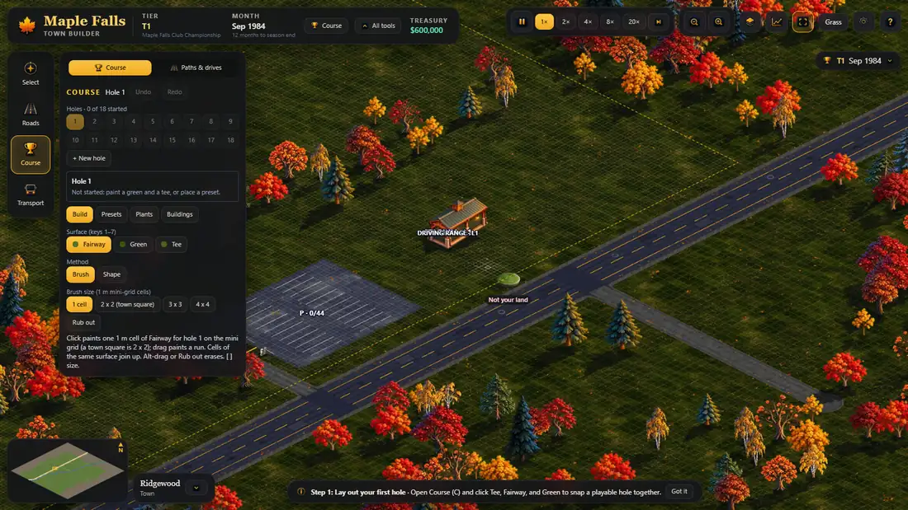 | 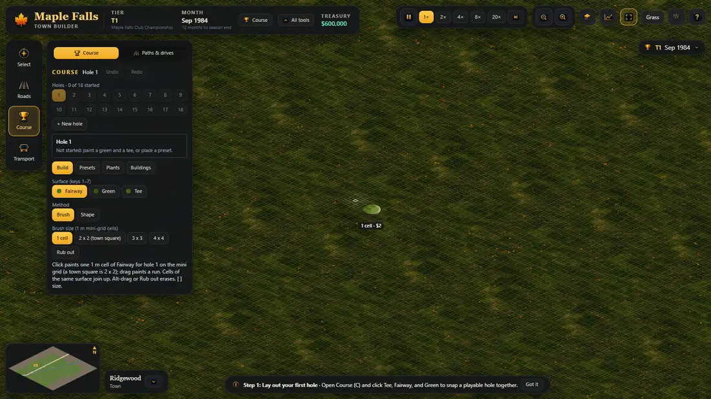 |
| A run of 2 x 2 cells and the checks (`a05`) | Paths & drives (`a08`) |
| 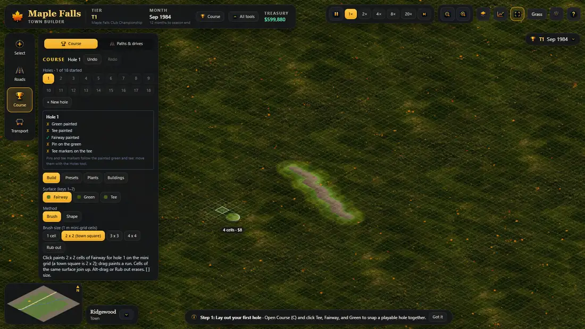 | 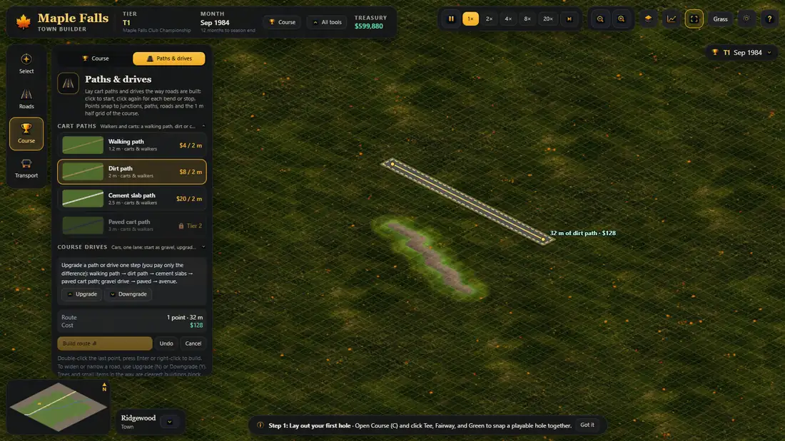 |
| All tools: the rail, the top bar, Stamps (`a09`) | The flag and the tee markers drawn as buildings (`a10`, `a11`) |
| 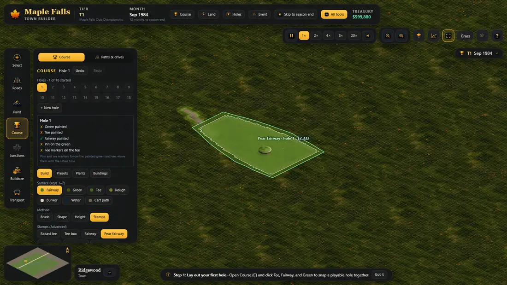 | 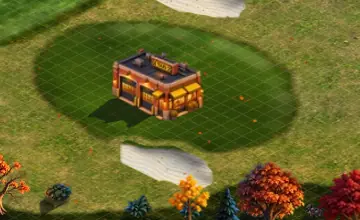 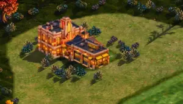 |

### 3.1 The problems (P1 misleads or blocks, P2 slows or confuses, P3 polish)

**The top ten, in order:**
1. **P1 Hidden modes hijack clicks.** The top bar's Grass panel, Land, Event (with a structure picked) and Holes chips are checked in
   `Engine.pointerDown` *before* the active tool (`engine.ts:2467-2492`). With Grass open every click inspects turf; with Land on a click
   buys; with Event armed a click places a tent, whatever the rail shows. The pointer and the panel still say "brush". Classic mode errors.
2. **P1 A hole by hand is 40–70 actions; the fast way is hidden.** A 40 m x 250 m fairway is 10,000 cells: with the 4 x 4 brush about ten
   parallel drags, each longer than the screen at 17%, plus a green (about 35 dabs) and a tee (my estimate; `a05` shows one run).
   The first-run hint promises "click Tee, Fairway, and Green to snap a playable hole together" (no such snap exists). The only fast path,
   Presets > "Generated: a new layout each time", is random, free (it charged $0 while cells cost money) and sits behind a tab name a
   beginner does not read as "make a hole". The wizard (T102) is not built yet.
3. **P1 The flag and the tee markers are drawn as buildings.** The pin and marker sprites are `business:` art (`golf/dressing.ts:11-19`),
   and `business` is a building kind (`mirror.ts:9`), so the new-art rule (`newart.ts` standInFamily) draws a small shop on every green
   and a mansion on every tee (`a10`, `a11`). The player cannot see where a hole starts and ends.
4. **P2 The Course panel shows everything at once.** At stage 1: Course / Paths & drives switch, "COURSE Hole 1 Undo Redo", an 18-chip
   hole grid of empty numbers, "+ New hole", a hole box, Build / Presets / Plants / Buildings tabs, "Surface (keys 1–7)" over three
   chips, a Method row, size pills, Rub out and a four-line paragraph (`a02`). Groups are mixed: "Build" and "Buildings" are neighbouring
   tabs meaning different things; Paths & drives is a road panel inside the Course menu.
5. **P2 You must pick a "current hole" before painting.** "+ New hole" does not make a hole; it selects the next free number. Paint beside
   hole 1 while hole 2 is selected and the cells belong to hole 2 (`paint-tool.ts` brushHole). The hole box then lists four red crosses
   ("Green painted, Tee painted, Pin on the green, Tee markers on the tee") for what is two dabs (`a05`).
6. **P2 Esc never leaves the tool.** From the brush, Esc goes to Shape, then back to the brush, then Shape again (measured:
   `course:draw -> course:brush -> course:draw -> course:brush`; `paint-tool.ts:915-920`). The only way out is the rail.
7. **P2 Two painters, two models.** Paint (polygons, styles, borders) and Course (1 m cells) both paint ground; Plants live in both.
   Paths & drives speaks road language ("Build route", "To widen or narrow a road, use Upgrade (N)"), and its prices read "$8 / 2 m"
   while cells read "$2" and Advanced sizes read "tiles" (`a08`, `a09`).
8. **P2 Unlocks count strokes and minutes.** `progressFacts` counts a "playable hole" per three strokes (`progress.ts:30`), and stage 3
   arrives after ten minutes whatever happened; Bunker and Water appear mid-task after three fairway strokes. "All tools" is a chip in
   the top bar next to status.
9. **P2 The top bar mixes status, reports, modes and tools:** Tier, Month, Course (stats), Land, Holes, Event, Skip, All tools, then
   Grass on the far right (`a09`). A second pill "T1 Sep 1984" (the minimised round panel) repeats them, and its text says "The
   tournament is at the end of August" during founding seasons, when there is none (`App.tsx:553`).
10. **P3 Grid and chip need tuning.** At 17% the 1 m half grid covers the whole view like graph paper (`a02`, `a07` shows the 2 m grid
   always on in dev); the 40 px chip is bigger than a 1-cell footprint (about 11 px at 17%), so the eye reads the chip as the brush; its
   label says "1 cell · $2" but not the surface or the hole (`a03`).

**More problems:**
- P2: the camera opens on the road side, so the first hover says "Not your land" (`a01`); the owned land is a thin dashed line.
- P2: the clubhouse needs a drive within 6 tiles, and nothing in the Buildings tab says how to make one; the tab is a text card with no
  picture of the building.
- P2: Undo and Redo exist only in the Course panel; the road tool's "Undo" removes a route point; Ctrl+Z does nothing in other tools.
- P2: panels come in three looks: the glass panels, the slate Event panel, and the plain Grass panel with raw checkboxes and selects; the
  Event and Grass panels open on the right and cover the map.
- P2: Stamps (Advanced) still draw the old glowing rim ghost with "Pear fairway · hole 1 · $2,332", unlike the brush's clean tint (`a09`).
- P3: "Surface (keys 1–7)" with three surfaces; "Method"; "Rub out"; "Presets" and its 18 disabled "empty" slots (studio only);
  "Brush size (1 m mini-grid cells)"; the hint bar's long sentences; the minimap's town chip far from the title.
- P3: path cards are good (pictures, prices, locks), but the variant chips, Fine tuning and the long help line all show at once.

## 4. The mental model: the course is a town you build

| In a town | On the course | Built with |
| --- | --- | --- |
| Parks | **Holes** (a tee, a green, the fairway and rough between, its bunkers, water and trees) | Holes: New hole, then cells |
| Streets | **Cart paths** (walking path, dirt, cement slabs, paved, avenue) and **course drives** (gravel, paved, avenue) | Paths, drawn like roads |
| Houses | **Course buildings** (clubhouse, pro shop, cart barn, halfway house; tents and stands for the tournament; the course's homes later) | Buildings, facing a drive or path |
| Gardens, trees | **Landscape** (trees, shrubs, flower beds, mulch, decor ground) | Landscape |
| The town around | The real town grows by itself (P22); its **roads** and **transport** carry the crowd | Roads, Transport |

Rules that follow from the model:
- **A hole is one thing.** You make it with New hole, click it to see one card, edit or delete it as a whole, and shape its cells. Cells
  you paint join the hole whose corridor they are in (section 6.2).
- **Streets connect everything.** Path ends snap to a green's and a tee's path point, to building fronts, to paths and to roads. A hole
  with no path to the next tee shows it on its card, with a Fix.
- **Houses face streets.** Buildings snap their front to the nearest drive or path and turn to face it; a link dot shows the join.
- **The town is built on two grids (T109):** the town grid of 2 m tiles (one road piece) and the course's mini grid of 1 m cells (a road
  tile split into four). Course surfaces and paths work on the mini grid; town roads on the town grid.

## 5. Information architecture

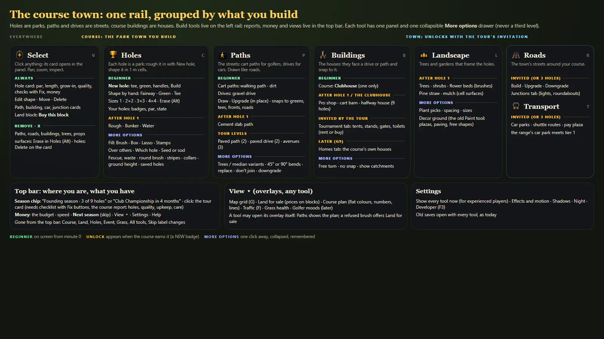

### 5.1 The rail (left), grouped

| Rail | Key | What lives there | Beginner sees | In More options |
| --- | --- | --- | --- | --- |
| **Select** | V | Click anything: its card opens in the panel (hole, path, building, car, junction, land block) | the card; Edit shape, Move, Delete | – |
| *Course* · **Holes** | C | New hole; shape by hand in 1 m cells; your holes | New hole; Fairway, Green, Tee; sizes 1, 2 x 2, 3 x 3, 4 x 4; Erase (hold Alt); hole badges | Fill: Brush, Box, Lasso; Stamps; Over others; Which hole; Seed or sod; Fescue, Waste; round brush; mowing stripes; collars; ground height; saved holes |
| *Course* · **Paths** | P | Cart paths and drives, drawn like roads | Cart paths: walking, dirt; Drives: gravel; Draw / Upgrade | Trees and median variants; 45° or 90° bends; replace; don't join; downgrade |
| *Course* · **Buildings** | B | The course's houses: they face a drive or path | Course tab: Clubhouse | Free turn; no snap; show catchments |
| *Course* · **Landscape** | L | Trees, shrubs, flower beds, mulch and pine straw, decor ground | (after hole 1) the plant brushes | Plant picks, spacing, sizes; decor ground (today's Paint tool: plazas, paving, free shapes) |
| *Town* · **Roads** | R | The town's roads; a Junctions tab | (when invited) Build, Upgrade | Downgrade, bends, replace, speed limits, centre lines |
| *Town* · **Transport** | T | Car parks, shuttle routes, the pay plaza | (when invited) car parks | Rows, on-street bays, fees |
| **Remove** | X | Removes paths, roads, buildings, trees and props | – | – |

- Surfaces are erased with Erase in Holes (hold Alt), and a hole is deleted from its card: Remove never deletes painted ground by
  surprise.
- **Where today's controls go:** Course → Holes; Paths & drives → Paths; Paint → Landscape > More options (decor ground); Plants →
  Landscape; Junctions → Roads (tab, J still jumps there); Bulldoze → Remove; Course > Buildings tab → Buildings; the top bar's Event →
  Buildings > Tournament tab; Holes chip (move pins and markers) → the hole card's Edit shape; Land chip → View > Land for sale and the
  land block's card; Grass → the course report's Care tab and View > Grass health; Course stats → the season card; All tools →
  Settings > Show every tool now; Presets → Holes > More options > Saved holes (the Generated hole is replaced by New hole).

### 5.2 The top bar: where you are, what you have

- **Left:** the place name (the range's, then the town's, P22); the **season chip** ("Founding season · 3 of 9 holes", later "Club
  Championship in 4 months") with a progress bar; **Money**.
- Clicking the season chip opens the **season card**: the tour's needs as a checklist with Fix buttons (9 holes · car park ✓ ·
  clubhouse ✗ [Place it]), then tabs for the course report (holes, par, length, quality, upkeep) and Care (today's Grass controls).
- Clicking Money opens the budget, as today.
- **Right:** pause and speed; **Next season** (today's Skip, with the same rules); **View ▾**; Settings; Help.
- **Nothing in the top bar arms a mode.** Every report opens as a card under its chip and closes with Esc or a second click.

### 5.3 View ▾ (overlays, in any tool)

Map grid (G) · Land for sale (block outlines with prices; click a block to buy) · Course plan (flat colours, hole numbers, playing lines,
corridors) · Traffic (F) · Grass health · later Golfer moods. A tool may open its overlay itself and close it when it ends: New hole
shows the other holes' corridors; a refused brush's "Buy land ▸" turns on Land for sale.

### 5.4 Beginner versus unlocked versus More options

Unlocks come from the course, never from stroke counts or timers. Each unlock adds a NEW badge on the rail item and one toast line.

| Stage | When | The player gains |
| --- | --- | --- |
| 1 · Your first hole | a new range game | Select, Holes (New hole, Fairway, Green, Tee, sizes, Erase), Paths (walking and dirt cart paths, the gravel drive), Buildings (Clubhouse), Remove |
| 2 · Founding the club | hole 1 exists (a derived hole with par > 0) | Rough, Bunker, Water; Landscape; cement slab path; pro shop and cart barn |
| 3 · The town | invited by the tour, or 3 holes, or year 2 | Roads, Transport; Buildings > Tournament; the halfway house at 9 holes |
| Tour levels | tier 2, 3 (`courseTierNeeded`) | paved paths and drives, avenues (shown locked with "Tour level 2") |

- **More options drawers exist from minute 0,** collapsed, and remember being open. They hold power, not progress.
- Settings > **Show every tool now** opens everything (today's All tools). Old saves open with every tool, as `normalizeProgress` does.
- The P22 first minute and guide map onto it: 1 Welcome (card) → 2 Build hole 1 (New hole) → 3 Place the clubhouse (Buildings; offers
  "Draw a drive" if none is near) → 4 Finish nine holes → 5 The invitation → 6 The tournament → 7 Results.

### 5.5 Names: old → new

| Today | Proposed | Why |
| --- | --- | --- |
| Course (rail) | **Holes** (in the Course group) | the tool builds holes; "Course" names the whole group |
| + New hole (selects a number) | **New hole** (the wizard) | the words should do what they say |
| Rub out | **Erase** | the common word |
| Method: Brush / Shape | (gone) Fill: Brush / Box / Lasso in More options | one way for beginners |
| Pieces / Stamps | **Stamps** (More options) | ready-made shapes stamped in cells |
| Presets, Generated | **Saved holes** (More options); New hole replaces Generated | plain words |
| Paths & drives | **Paths** (tabs: Cart paths, Drives) | short; the tabs carry the detail |
| Build route ⏎ | **Build · $384** | the price on the button |
| Bulldoze | **Remove** | plain |
| Plants; Paint | **Landscape**; decor ground under Landscape | one place for decoration |
| Event (top bar) | Buildings > **Tournament** | tents and stands are buildings |
| Tier T1 | **Tour level 1 · Club Championship** | the event name first |
| Skip to tournament / season end | **Next season** (the tooltip says what happens) | one label |
| $8 / 2 m; tiles | **$4 a metre**; metres | one unit per kind: metres for paths, m² for surfaces |

## 6. The core flows (clicks counted)

Counts start with the tool closed and end when the thing is built. "Today" is main at `223849a`.

### 6.1 Build a hole as a park (New hole, T102) — mockup m2

1. Holes (C), then **New hole** (N): the pointer carries a tee ghost; the other holes' corridors show faintly; near the last green
   the tee snaps to a sensible spot and the label says "Tee · hole 2 · 85 m walk from hole 1".
2. **Click the tee.** The pointer now carries the green; a live ghost runs from the tee: centre line, fairway with real widths, green,
   tee, rough corridor, yardage ticks every 50 m, and at the pointer "Hole 2 · par 4 · 357 m · $31,600". Par snaps at 230 m and 430 m
   with a small pop.
3. **Click the green.** The plan stays open with handles: drag the dashed line to bend it (a "+" on the line adds a bend, up to 3),
   drag ◆ to widen or narrow the fairway there, drag T or the flag to move them, [ ] green size, R green shape. The panel shows the hole
   card: par, length, the price split (fairway, green, tee, rough and collars), Seed or Sod with both prices and the ready month, and
   the checks (on your land, clear of roads, 60 m from other holes, the walk from the last green) with a Fix where one applies.
4. **Build** (Enter, or "Build · $31,600"). The cells fill as a ripple from tee to green; the hole badge pops; one undo step.
5. Esc steps back: the green, then the tee, then out of New hole. Nothing is paid until Build.

| | Today | Proposed |
| --- | --- | --- |
| A straight par 4 | 40–70 actions with the brush (estimate), or Presets > Generated > click: 3 clicks, random, no control | **4 clicks** (New hole, tee, green, Build) + opening the tool |
| A dogleg with a wider landing zone | not possible in one tool (doglegs read "off the course", P21 1.1) | **6–7**: + drag the bend, + drag a width handle |

### 6.2 Shape by hand (the cell brush, T108 + T109) — mockups m3, m8

1. In Holes, press **1–6** or click a swatch (Fairway, Green, Tee; Rough, Bunker, Water from stage 2). Picking a swatch arms the brush:
   there is no Method row.
2. Pick a size (1, 2 x 2, 3 x 3, 4 x 4; [ ] keys). The footprint is the exact cells on the 1 m half grid; the chip beside the pointer
   reads "Bunker · 4 m² · $16" and, on a second line, "hole 1 · sand: no grow-in".
3. **Click** paints the footprint; **drag** paints a gap-free run; the run's total shows at the pointer while dragging.
4. **Hold Alt** to erase (cells go back to rough, then to grass); **hold Shift** to paint over other surfaces (by default a stroke slides
   past higher surfaces, so a fairway stroke never eats the green).
5. **Esc** drops the brush (the panel stays, nothing armed); Esc again leaves to Select.

**Which hole a cell joins:** the hole whose corridor (the plan's line, else the derived tee-to-pin line, within 30 m) holds it; between
two corridors the nearer line; outside all corridors no hole (practice or decoration). More options > Which hole can lock it to one hole
for overlaps. The current-hole picker goes.

| | Today | Proposed |
| --- | --- | --- |
| Add a bunker by a landing zone (stage 1 player) | not possible until 3 strokes unlock stage 2; then pick hole, Bunker, size, dabs | 5 (key) · size · 2–4 dabs |
| Fix a ragged fairway edge | select the right hole first, else the cells go to another hole | key 1 · drag |

### 6.3 Lay cart paths and drives like streets (P19, T070) — mockup m5

1. **Paths (P).** Cart paths is the default tab, Dirt the default kind; Drives is the other tab (the gravel drive from the start).
2. **Click the start.** Points snap (shown by green rings) to a green's or tee's path point, building fronts, paths, roads and the half
   grid; Shift keeps a straight run; Q switches 90° or 45° bends (in More options).
3. **Click each bend; double-click** the end (or Enter). The route is a ghost with its length and price at the pointer:
   "96 m of dirt path · $384".
4. A path across a road gets a cart crossing, never a junction (P19).
5. **Upgrade** (U, the Draw / Upgrade switch) steps a path up its ladder where you click; you pay the difference.

| | Today | Proposed |
| --- | --- | --- |
| A path from a green to the next tee | Course, Paths & drives, card, 2+ clicks, Build route: **6** | Paths, 2 clicks with a double-click: **3**; or the wizard's "Path after Build" chip: **1** + check |
| A drive to the clubhouse spot | Course, Paths & drives, open Course drives, card, points, Build: **7** | Paths, Drives, points: **4** |

### 6.4 Place course buildings (P19 T069b, P22 T089) — mockup m6

1. **Buildings (B)**, then the card (with its picture and price). The ghost follows the pointer as the building's picture.
2. Near a drive or path (12 m), its **front snaps to the verge and it turns to face it;** a white link dot marks the join.
3. **Click** builds it. R turns it when nothing is near; Esc stops.
4. Refused: the footprint turns red with the reason ("Needs a drive within 12 m", "On hole 2's corridor", "Off your land") and a Fix
   ("Draw a drive" opens Paths > Drives starting at the nearest road; "Buy land ▸" turns on Land for sale).

Today: Course, Buildings tab, click = 3 (no picture, no fix when there is no drive). Proposed: B, card, click = **3**, with the fix.

### 6.5 Edit, move, delete, undo

- **Edit a hole's shape:** Select (V), click the hole, Edit shape: the wizard's handles return (tee, green, bends, widths, pin and
  markers); Enter applies (re-plans only the cells that differ; hand-painted bunkers and water stay, P21 3.3). **4 clicks** + drags.
- **Move a building:** Select, click it, Move, click the new spot (it snaps). **4.** Moving a whole hole is a later ticket.
- **Delete:** Select, click, Delete (the button asks once, inline: "Click again to delete hole 2"). **4.** Or Remove (X) and click
  (paths, buildings, trees): **2**.
- **Undo:** Ctrl+Z, or the panel's ↶ whose tooltip names the action ("Undo: Fairway, 60 m²"). The goal (U18): every build action in
  every tool is one undo step, and refunds follow what is undone. Today only the Course tool has undo.

### 6.6 Inspect a hole — mockup m7

Select (V), click anywhere on the hole: the rest of the map dims and the hole's card opens in the panel: name, par, length (m and
yd), grow-in (ready month and a bar), quality with its reasons, checks with Fix buttons, money (built for, upkeep, this season's golfers
and green fees), and Edit shape · Move · Delete. **2 clicks.** Today: a hole chip shows par, length and a checklist; quality and money
are in the top bar's Course stats (stage 3 only), so 2–3 clicks across two panels.

### 6.7 Buy land

View ▾ > Land for sale: buyable blocks show their price; click one, its card says "Buy this block · $X" (2 + 2 clicks). From a refused
brush, the chip's "Buy land ▸" turns the overlay on directly (1 + 2). Today: Land chip, then any click buys while the chip is on.

### 6.8 The first minute (P22 2.8, revised) — mockup m1

| Time | The player sees | The player does |
| --- | --- | --- |
| 0 s | The range on Route 9; the course land lit gold, the range plot hatched, the road side dimmed; a welcome card with three steps; the rail shows four tools and Remove | clicks **Build your first hole** |
| 3 s | The camera eases onto the course land; New hole is armed; a pulsing ring at a suggested tee spot (P06 `newHoleSpot`) | clicks a tee, then a green |
| 20–40 s | The live plan: par, length, price; handles | drags the bend (optional), presses Build |
| ~45 s | Hole 1 ripples in as dirt; the badge pops; the guide moves to "Place the clubhouse" | the first street rolls out across the road (P22) |

## 7. Feedback and previews

### 7.1 One ghost language for every tool

| State | Look | Words at the pointer |
| --- | --- | --- |
| Ready | translucent fill in the result's own colour + a crisp 1.5–2 device-px edge on the cell or footprint edges | what, how much, the price: "Fairway · 16 m² · $32" |
| Slides past | the cells it will not change: no fill, a faint dashed outline | "7 cells kept: the bunker stays (Shift paints over)" |
| Partly refused | muted red only on the cells or segments that cannot go | the reason and one Fix: "8 cells off your land · Buy land ▸" |
| Erase (Alt) | dashed edge, the colour of what you get back | "Erase · 16 m² back to rough · free" |
| Not enough money | the price turns red; nothing else changes | "Fairway · $3,200 · you have $2,100" |
| Planned (wizard, blueprint) | sky-blue dashed outline | "Hole 2 tee · planned" |
| Snap | a green ring on the target; a white link dot for buildings | "Starts at hole 1's green" |

- Price = only what changes (P21 3.5): cells that change, path metres, the building. The panel's primary button repeats it.
- Refusals are a headline plus the reason, in the game's words, never a bare "cannot place" (the RollerCoaster Tycoon pattern).

### 7.2 The grids

- **The 2 m map grid** (T100, G): off by default in the shipped game, on in dev; a Settings switch and G. Recommendation: the owner
  tries both and decides (T100 called it an evaluation).
- **The 1 m half grid** shows as a **spotlight** round the pointer (radius about 8 m, fading with distance) while a cell tool is armed,
  not over the whole view; every second line is a touch stronger (it meets the 2 m grid); hidden below 12% zoom. Snapping is always on.

### 7.3 The surface chip (T108)

- 40 px, lower right of the pointer, the armed surface's real photo as a little lit disc (sun upper right), with a soft shadow.
- Its label names the action (surface, m², price) and a second line (the hole and the grow-in, or the reason and Fix). It flips left or
  up near the screen edges, hides while panning and over panels, and never covers the footprint.
- At 1 cell and far zoom the footprint is tiny (about 11 px across at 17%, 8 px at 12%), so the footprint's edge is drawn 2 device px
  bright and the chip keeps its offset; below 12% zoom the cell brush pauses and the chip says "Zoom in to paint cells".

### 7.4 Motion (P21 3.5 kept, with limits)

- Only `transform` and `opacity`; press feedback 100–150 ms (scale .94 → 1 with a `linear()` spring); panels and drawers 180–250 ms;
  a hole badge pops once when the hole turns valid; the wizard's build ripple 600 ms; a light squash per click, nothing per dab beyond it.
- `prefers-reduced-motion: reduce` or Settings > Effects and motion off: fades only, no particles, no scaling, camera jumps instead of
  flying.

## 8. Layout and visual design

### 8.1 Where things sit (1600 x 900; scales down to 1366 x 768)

- **Rail:** left, 82 px wide, under the top bar; icons 28 px with labels always visible; group labels (Course, Town) in small caps;
  the key letter in the corner; a gold NEW badge on unlock.
- **Tool panel:** 336 px, beside the rail, top aligned, at most the viewport height less the top bar and 16 px; scrolls inside.
- **The right side stays map,** except cards that open under their top-bar chip (season, money, View) and close with Esc.
- **Bottom centre:** one hint pill: the armed tool's keys as keycaps, or the guide's step. **Bottom left:** the minimap.
- **Toasts:** top centre, under the top bar, 4 s.

### 8.2 Panel anatomy (the same in every tool)

1. Header: icon badge, title (Georgia), a one-line purpose ("Each hole is a park: build it, then shape it"), ↶ ↷.
2. The primary action as a gold pill with its key (New hole · N; Build · $X).
3. The beginner controls (swatches, sizes, cards).
4. The tool's objects (Your holes: badges for the holes that exist and a "+"; their colour says planned, growing, ready or a problem).
5. **More options ▸** with a short list of what is inside ("stamps · fill tools · seed or sod · height"), collapsed by default and
   remembered.

### 8.3 Keys

| Key | Does | Today |
| --- | --- | --- |
| V C P B L R T X | Select, Holes, Paths, Buildings, Landscape, Roads, Transport, Remove | P car park, B bottlenecks, L lanes (debug), T toll, X bulldoze |
| N | New hole (in Holes) | N upgrade |
| 1–6 | surfaces (Holes); path kinds (Paths) | 1–6 road classes |
| [ ] | size | same |
| Alt (hold) / Shift (hold) | erase / paint over; straight run | Alt erase |
| U | upgrade (Paths, Roads) | U bus route |
| J | the Junctions tab of Roads | J junctions |
| Enter, Esc, Ctrl+Z, Ctrl+Y | build, step back, undo, redo | Esc ping-pongs |
| G, F, Space, , . | map grid, traffic, pause, speed | same |

The debug keys (lanes, lots, access) move behind Developer (F3); bottlenecks to View. Help gets a Keys page.

### 8.4 The look

Rounded glass panels (18 px), pill buttons, one gold primary action per panel (`#ffcd52` → `#f0a91e`, dark text), round droplet swatches
of the real photos, Georgia titles, small-caps section labels, the owner's gold icons. Colours with one meaning each: green ready, amber
growing or attention, red refused, sky blue planned. One panel style for every panel (the Event and Grass panels join it).

## 9. Mockups

Static HTML in `docs/plans/P23-ux/mockups/` (sources; backgrounds are the real game with the UI hidden, overlays drawn on the real iso
grid from the saved camera), rendered to WebP here by `render.mjs`:

| File | State |
| --- | --- |
| `P23-ux/m0-ia.webp` | the information architecture |
| `P23-ux/m1-start.webp` | the first minute: welcome card, the stage-1 rail and Holes panel, the course land lit |
| `P23-ux/m2-wizard.webp` | New hole mid-build: the live plan, handles, yardage, the walk, the hole card with the price split, Seed or Sod, checks |
| `P23-ux/m3-brush.webp` | shape by hand: the swatches, the 2 x 2 footprint on the half-grid spotlight, the chip with its label |
| `P23-ux/m4-advanced.webp` | More options open: Fill Box in action, stamps, planting, stripes, collars, height |
| `P23-ux/m5-paths.webp` | Paths: cart path cards, a route from a green to a planned tee, snap rings, the price at the pointer |
| `P23-ux/m6-buildings.webp` | Buildings: the clubhouse snapping its front to a drive, the link dot, picture cards, Tournament tab |
| `P23-ux/m7-inspect.webp` | Select a hole: the map dims, the hole card with grow-in, quality, checks with Fix, money, actions |
| `P23-ux/m8-states.webp` | the brush's four states: ready, slides past, partly refused, erase |

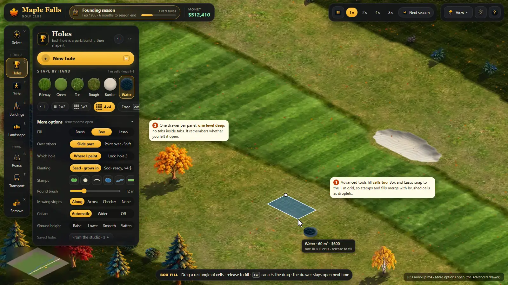
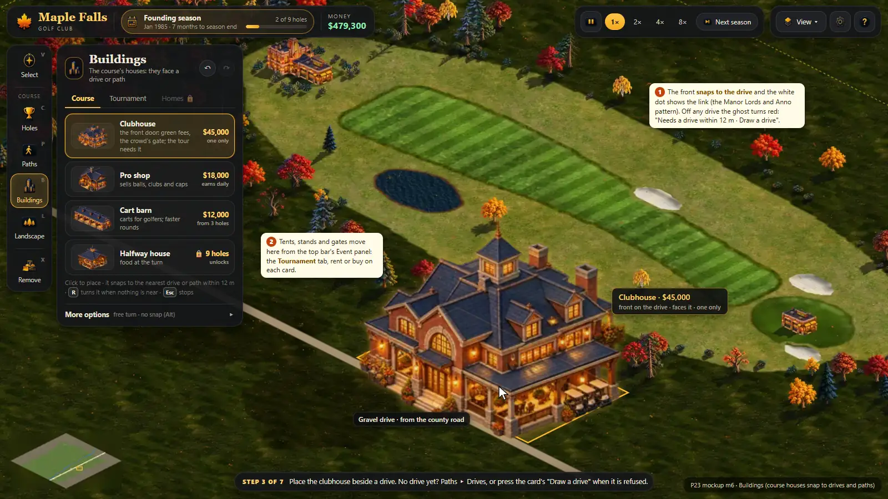
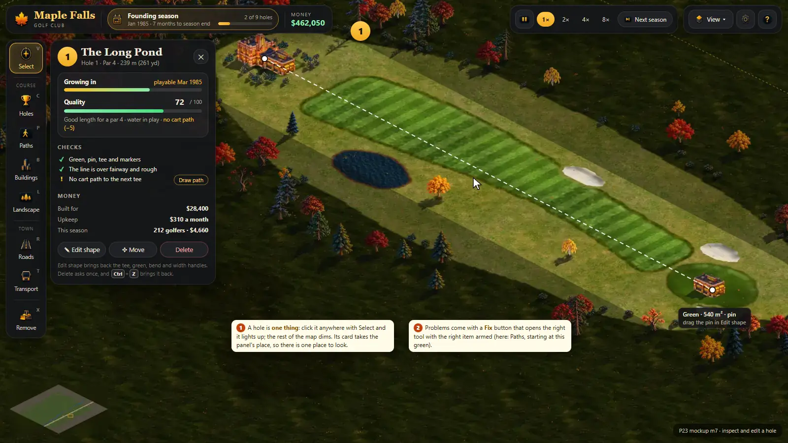
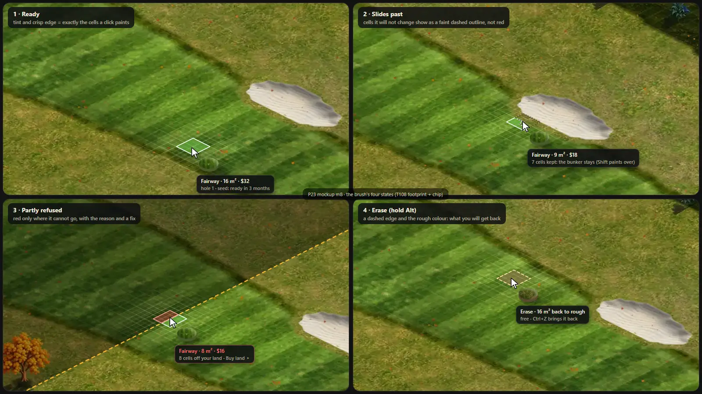

## 10. Risks, doubts and open questions (for the critic)

1. **Inferring a cell's hole from where it is** (6.2) changes how holes are tagged. Overlapping corridors, a double green and a new
   hand-made hole (a tee and a green painted with no wizard) need rules; I propose "nearest line, lock in More options", and for a
   hand-made tee and green a suggestion "Make this hole 3?". Doubt: is removing the current hole too big a change before T102 lands?
2. **The beginner flow depends on T102** (the wizard), which is not built. Until it lands, stage 1 is the cell brush plus the Generated
   hole renamed "Quick hole"; the welcome card's "about a minute" waits for T102.
3. **Re-keying** (P, B, N, T, U, L) breaks the owner's muscle memory and the dev keys. Recommendation: follow the rail's letters and add a
   Keys page; the critic may prefer keeping today's keys.
4. **Renaming Course to Holes:** the owner says "the Course tool". The group label keeps "Course"; the item says what it builds.
5. **Paint leaves the rail** for Landscape > More options. The owner used Paint for plazas and road colours; one extra click for him.
6. **One undo for every build tool** is engine-wide work (Parkitect's developer said undo doubles the code of every action). Phase it:
   Ctrl+Z routes to the active tool's own stack first; a shared journal later.
7. **Moving a whole hole** (cells and plan, with collisions) is valuable and risky: left as a later ticket.
8. **The panel is 336 px:** with the rail it takes 32% of a 1366 px screen. A compact panel (collapse to the rail) may be needed.
9. **The flag drawn as a house** is an art-pipeline rule (`newart.ts`): exempting golf markers is a judgement call for the art side; I
   treat it as a bug.
10. **Season chip as the door to the course report:** status chips are not always clicked; the Holes panel also links "Course report".
11. **The always-on map grid** was the owner's experiment (T100); I recommend off by default with the half-grid spotlight, and the owner
    decides after trying.
12. **Out of scope here:** the tournament-day UI (the live surge, results), touch screens, gamepads, localisation (P17), audio (P13).
13. **The 1-cell default (the owner's T109 rule)** makes shaping precise but slow for big touch-ups; 2 x 2 might be the better default
    once New hole exists. Kept as the owner asked.
14. **Unverified numbers:** the 40–70 actions for a hand-built hole and the clicks in "Today" columns are my measurements and estimates
    from the scripted audit, not a user test. A 3-person hallway test of m1–m3 as click-through prototypes would check them.

## 11. Draft tickets

**G** changes gameplay or rules; **L** is layout and words only. U-numbers are placeholders: the lead gives them T-numbers when they are
posted. Checks for every ticket: `npm run typecheck`, its own tests, and screenshots at 30% and 17% compared with the mockup named. The
lead runs the full suite and the bench.

**Quick fixes first (small, independent):**
- **U1 Modes never hijack clicks** (G). `engine.ts` pointerDown, setTool; App.tsx chips. Land, Grass, Event and Holes no longer
  intercept clicks for other tools: switching tools turns them off, each shows a pointer label and Esc leaves it, until U12/U13 move
  them. Test: with Land on, `setTool('course')` clears it and a brush click paints.
- **U2 Esc steps out** (L/behaviour). `paint-tool.ts` key(): Esc cancels the stroke or plan, then drops the armed surface, then leaves
  to Select; no Brush–Shape ping-pong. Test: the Esc ladder.
- **U3 The flag and markers draw as a flag and markers** (L, visible). `newart.ts`: golf pins, tee markers, carts, bag trolley and
  benches are props, not buildings: exempt them from the building stand-in (an allow list), or draw a simple flag and marker until
  their art exists. Check: a hole at 30% and 17% shows a flag on the green and markers on the tee.

**The beginner experience (in order):**
- **U4 The rail regrouped** (L). `App.tsx` GROUPS, `progressive-ui` ids: Select · Course (Holes, Paths, Buildings, Landscape) · Town
  (Roads with a Junctions tab, Transport) · Remove; group labels, keys on the buttons, NEW badges; Paint under Landscape.
- **U5 Unlocks from the course** (G, progression). `progressive-ui/index.ts`, `progress.ts`: stage 2 = a derived hole with par > 0
  (`courseHoleViews`, not strokes / 3); stage 3 = invited or 3 holes or year 2; no 10-minute rule; the lists of 5.4; Show every tool now
  in Settings; unlock toasts. Tests: the stage table.
- **U6 The Holes panel** (L; supersedes T103's layout). `ui/course/CoursePanel.tsx`, `HoleStrip.tsx` → hole badges, `index.css`: the
  anatomy of 8.2, swatches 1–6, sizes, Erase, Your holes, More options (Fill, Stamps, Over others, Which hole, Planting, Fescue and
  Waste, round brush, stripes, collars, height, saved holes). Removes the 18-slot grid, the tabs, the Method row and the paragraph.
  Mockups m1, m3, m4.
- **U7 New hole as designed** (G; extends T102's spec). `paint-tool.ts` plan mode, `engine.ts`: the stepper, the hole card with the
  price split, Seed or Sod with prices and ready month, the checks with Fix, Esc stepping back, other holes' corridors shown, the walk
  line, par snap pop, "Build · $X". Mockup m2. After T102 or as its UI half.
- **U8 Cells join the hole they are in** (G, RISKY: hole tagging). `paint-tool.ts` gridOpts and strokeStart, `golf/holes.ts`: the cell's
  hole from the nearest corridor line within 30 m, else 0; Which hole lock in More options; the current-hole picker goes. Tests: beside
  hole 1 → hole 1; between two holes → the nearer; outside → 0; a plan edit keeps them.
- **U9 The chip names the action; the four states** (L; extends T108). `ext/course-cursor`: the two-line label, edge flipping, hide
  while panning; slides-past cells dashed; red only on refused cells with one Fix (Buy land ▸). Tests: ext-course-cursor; mockup m8.
- **U10 The half grid as a spotlight; the map grid off by default** (L). `ext/map-grid/layer.ts`, engine setting default. Tests:
  ext-map-grid; bench with the grid on.
- **U11 The Paths panel** (L). A `PathsPanel` from RoadPanel's course scope: Cart paths and Drives tabs, Draw / Upgrade, cards with
  prices a metre, the route box, "Build · $X"; variants, bends, replace and downgrade in More options. Mockup m5.
- **U12 Buildings with pictures and a Tournament tab** (L + small G). The Course tab cards with art; the Event catalogue moves into the
  Tournament tab (rent or buy on each card); the clubhouse refusal's "Draw a drive" fix. Needs T069b for structures. Mockup m6.
- **U13 Select opens a card; the hole card** (L + small G). `SelectPanel` → cards for holes (par, length, grow-in, quality reasons,
  checks with Fix, money, Edit shape, Move, Delete), paths, buildings and land blocks (Buy). The Holes chip becomes Edit shape. Mockup m7.
- **U14 The top bar** (L). The season chip and its card (needs with Fix, course report, Care tab), Money, time, Next season, View ▾
  (Map grid, Land for sale, Course plan, Traffic, Grass health), Settings, Help. Removes Course, Land, Holes, Event, Grass, All tools and
  the duplicate round pill; fixes its founding-season sentence.
- **U15 The hint pill and the welcome** (L; with T095). The armed tool's keycaps or the guide's step; the welcome card of m1; the
  stage-1 hint text matches what exists.
- **U16 The panel look and motion** (L; merges T103's motion). Pills, droplet swatches, the gold primary, 18 px radius, the `linear()`
  spring, the reduced-motion block, Settings > Effects and motion; the Event and Grass panels restyled.
- **U17 Keys follow the rail** (behaviour). `engine.ts` keyDown: V C P B L R T X, N, U, J; debug keys behind Developer; Help > Keys.
- **U18 One Ctrl+Z, named** (G, RISKY: engine-wide). Ctrl+Z / Ctrl+Y in every build tool, the ↶ tooltip names the action; roads,
  paths and buildings undo their last build with its refund. Phase 1: per-tool stacks behind one key.
- **U19 One price rule** (G, money). Saved holes, stamps and the Generated hole charge their cells like the brush (today the Generated
  hole is free); prices in m² and metres everywhere.
- **U20 The wizard's companions** (G; after T102 and T105). "Path after Build": a cart path pre-routed from the last green to the new
  tee, one click; later, Move a whole hole.

**Order:** U1, U2, U3 now (independent). Then U4 + U5 + U6 together (the rail, the stages and the panel are one change for the player),
U9 + U10 (T108 follow-ups), U7 with T102, U8 after U7, U11, U12, U13, U14, U15 with T095, U16 with or instead of T103, U17, U18, U19,
U20. **Overlaps:** U6 and U16 supersede T103's layout; U9 finishes T101's label; U7 is T102's UI; U11 uses T070; U12 needs T069b.

## 12. Sources

Principles:
[Progressive Disclosure (NN/g)](https://www.nngroup.com/articles/progressive-disclosure/) ·
[Hamburger menus and hidden navigation (NN/g)](https://www.nngroup.com/articles/hamburger-menus/) ·
[Hick's Law (Laws of UX)](https://lawsofux.com/hicks-law/) ·
[A predictive model of menu performance (Cockburn, Gutwin, Greenberg, CHI 2007)](https://doi.org/10.1145/1240624.1240723) ·
[Fitts's Law (NN/g)](https://www.nngroup.com/articles/fitts-law/) ·
[A quiz designed to give you Fitts (AskTog)](https://www.asktog.com/columns/022DesignedToGiveFitts.html) ·
[Shift (Vogel and Baudisch, CHI 2007)](https://www.patrickbaudisch.com/projects/shift/index.html) ·
[Recognition and recall (NN/g)](https://www.nngroup.com/articles/recognition-and-recall/) ·
[Icon usability (NN/g)](https://www.nngroup.com/articles/icon-usability/) ·
[Direct manipulation (NN/g)](https://www.nngroup.com/articles/direct-manipulation/) ·
[Crossing the bridge over Norman's gulf of execution (Vermeulen et al., CHI 2013)](https://doi.org/10.1145/2470654.2466255) ·
[Visibility of system status (NN/g)](https://www.nngroup.com/articles/visibility-system-status/) ·
[Preventing user errors: slips (NN/g)](https://www.nngroup.com/articles/slips/) ·
[Preventing user errors: mistakes (NN/g)](https://www.nngroup.com/articles/user-mistakes/) ·
[User control and freedom (NN/g)](https://www.nngroup.com/articles/user-control-and-freedom/) ·
[Consistency and standards (NN/g)](https://www.nngroup.com/articles/consistency-and-standards/) ·
[Modes in user interfaces (NN/g)](https://www.nngroup.com/articles/modes/) ·
[The prevention of mode errors through sensory feedback (Sellen, Kurtenbach, Buxton 1992)](https://billbuxton.com/ModeErrors.html) ·
[The Humane Interface (Raskin)](https://www.raskincenter.org/jef/humane-interface/) ·
[Onboarding tutorials vs contextual help (NN/g)](https://www.nngroup.com/articles/onboarding-tutorials/) ·
[The Gamer's Brain, part 2: UX of onboarding (Hodent)](https://celiahodent.com/gamers-brain-ux-onboarding/) ·
[The impact of tutorials on games of varying complexity (Andersen et al., CHI 2012)](https://grail.cs.washington.edu/projects/game-abtesting/chi2012/) ·
[prefers-reduced-motion (MDN)](https://developer.mozilla.org/en-US/docs/Web/CSS/@media/prefers-reduced-motion) ·
[Understanding SC 2.3.3 Animation from interactions (W3C)](https://www.w3.org/WAI/WCAG22/Understanding/animation-from-interactions.html) ·
[Animation duration (NN/g)](https://www.nngroup.com/articles/animation-duration/) ·
[High-performance CSS animations (web.dev)](https://web.dev/articles/animations-guide) ·
[Proximity (NN/g)](https://www.nngroup.com/articles/gestalt-proximity/) ·
[Match between the system and the real world (NN/g)](https://www.nngroup.com/articles/match-system-real-world/).

Games:
[Sid Meier's SimGolf (Wikipedia)](https://en.wikipedia.org/wiki/Sid_Meier%27s_SimGolf) ·
[SimGolf review (GameRevolution)](https://www.gamerevolution.com/review/33105-sid-meiers-simgolf-review) ·
[PGA TOUR 2K25 course designer tips (2K)](https://pgatour.2k.com/2k25/up-your-game/course-designer/) ·
[PGA TOUR 2K23 course designer (2K)](https://pgatour.2k.com/2k23/up-your-game/course-designer/) ·
[PGA Tour 2K21: how to design a course (Game Rant)](https://gamerant.com/pga-2k21-design-course-guide/) ·
[Two Point: room templates deep dive](https://community.twopointcounty.com/two-point-studios/two-point-hospital/blogs/9-room-templates-deep-dive) ·
[Two Point Campus: creativity tools breakdown](https://www.twopointstudios.com/es/node/1888) ·
[When we made Two Point Hospital (MCV)](https://mcvuk.com/development-news/when-we-made-two-point-hospital/) ·
[Cities: Skylines dev diary 1: roads (Paradox)](https://forum.paradoxplaza.com/forum/threads/cities-skylines-dev-diary-1-roads.802639/) ·
[Info views (CS wiki)](https://skylines.paradoxwikis.com/Info_views) ·
[Milestones (CS wiki)](https://skylines.paradoxwikis.com/Milestones) ·
[Cities: Skylines II dev diary 1: road tools (Paradox)](https://forum.paradoxplaza.com/forum/developer-diary/development-diary-1-road-tools.1590300/) ·
[How roads became the backbone of CS2 (Game Developer)](https://www.gamedeveloper.com/design/how-colossal-order-turned-roads-into-the-backbone-of-cities-skylines-ii) ·
["Overlapping items" (Steam, CS2)](https://steamcommunity.com/app/949230/discussions/0/3877095833473231872/) ·
[Planet Coaster 2: building your park](https://www.planetcoaster.com/player-guides/building-your-park) ·
[Planet Coaster 2 review (COGconnected)](https://cogconnected.com/review/planet-coaster-2-review/) ·
[Planet Zoo: building your zoo](https://www.planetzoogame.com/help-centre/player-guides/building-your-zoo) ·
[Parkitect devlog 130](https://www.texelraptor.com/blog/devlog-update-130) ·
[Parkitect: undo changes? (Steam)](https://steamcommunity.com/app/453090/discussions/1/1741101364298060025) ·
[OpenRCT2 footpaths](https://docs.openrct2.io/en/latest/playing/footpath/index.html) ·
[OpenRCT2 UI strings](https://raw.githubusercontent.com/OpenRCT2/OpenRCT2/develop/data/language/en-GB.txt) ·
[How Townscaper works (Game Developer)](https://gamedeveloper.com/blogs/how-townscaper-works-a-story-four-games-in-the-making) ·
[Islanders (Wikipedia)](https://en.wikipedia.org/wiki/Islanders_(video_game)) ·
[Strategic minimalism behind Islanders (WN Hub)](https://wnhub.io/news/analytics/item-2245) ·
[Anno Union: UI/UX dev blog](https://www.anno-union.com/?p=9862) ·
[Anno Union: roads and building in the grid (117)](https://www.anno-union.com/?p=20685) ·
[Doodle designer: Tiny Glade](https://indiegames.substack.com/p/doodle-designer-tiny-glade) ·
[Manor Lords roads (Game8)](https://game8.co/games/Manor-Lords/archives/452353).
Earlier golf, brush and juice research: P21 section 2.
