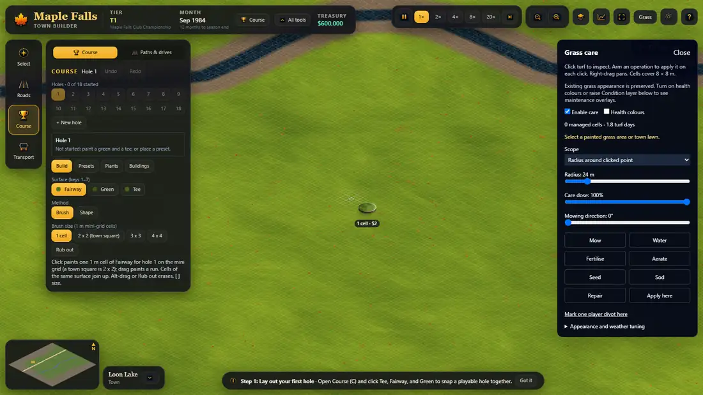
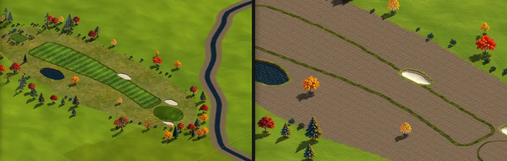
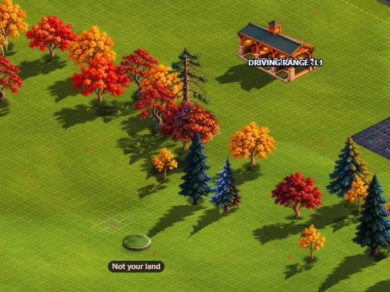
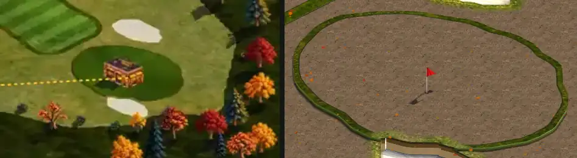

# P23 critique of plan v1 (the course town UX)

Status: **critique of v1** (2026-10-25), for the planner's v2. Plan read: `docs/plans/P23-UX.md` at `9259e55` (cut from main `223849a`).
Checked against today's main **`d1218f2`** (after #194 painted grass, #195/#180/#182 art as files, #200 props draw themselves, #201 3D
collars, #203 stand-in labels). Nothing in P23-UX.md was changed.

**Method.** My own Vite server on 127.0.0.1:5483 from a detached worktree of main; headless Chrome (playwright-core) at 1600 x 900 and
1366 x 768, dpr 1; production-like flags `?unlock=0&money=0&grow=1&grid=0` (unlocks played, real money, real grow-in, map grid off as in a
production build); scripted clicks, keys and probes through `window.__game`; nine fresh range games (each has its own seed). I read
T102's in-flight worktree (`arena/T102-hole-wizard`) and the living-ground worktree without touching them. Evidence images are in
`critique/` (k01-k11); line numbers are main `d1218f2`. Ratings: **Blocker** (v2 cannot ship that part as written), **Major** (players
will get stuck or the owner will reject it), **Minor** (polish or a cheap fix).

---

## Executive summary: the five most important problems

1. **Building a hole is still not "as easy as building a street" (Major).** v1's "4 clicks" (6.1) leaves out the camera. A par 4 does
   not fit the screen at the start zoom (17%): a 241 m generated hole spans 1,288 px with its tee under the panel (`c6`, k04 right), and a
   357 m one needs about 10% zoom, the band where v1 itself hides the half grid and pauses the cell brush (7.2, 7.3). Bends are a
   drag-the-line grammar, while every road and path is click-per-bend and finish. The hand tool is a paintbrush with no street gesture
   at all. **v2:** draw a hole exactly like a road (click the tee, click each bend, finish on the green with the road's own finish
   gestures), frame the camera automatically, keep the handles for afterwards, and give the hand tools a road-like "run".
2. **"Cells join the hole they are painted in" (6.2, U8) breaks hand-built holes and has no rules for the hard cases (Blocker).**
   Outside every corridor a cell gets hole 0, and before a hole exists there is no corridor, so a hand-painted tee and green never become
   a hole: no par, and no stage-2 unlock (U5 unlocks on a derived hole). Shared ponds, a double green, a new hole stealing an old hole's
   bunker and plan edits are all undefined, and U8 rewrites the `brushHole` model that T102 is building on right now. **v2:** an
   automatic, visible current hole; specify U8 only with tests for those cases, or drop it.
3. **The feedback that matters most lies today, and v1 does not see it (Major; the land part is a Blocker).** The same seeded hole looks
   grown at 8% and bare dirt from 11% to 30% (k04, k11). While it grows, every surface is the same brown with thin green kerbs, so a beginner's
   first hole is unreadable for months (k04, k05). The brush says "Not your land" over the player's own range plot (k02). And land
   cannot be bought at all in a range start: the 40-tile blocks never touch the off-lattice parcel (0 hits in 4,032 probes over two
   games), so v1's "Buy land ▸" fix and View > Land for sale lead nowhere.
4. **The town metaphor is a label, not a structure, and the IA drops or buries what people use (Major).** There are two street tools
   (Paths and Roads), with drives possibly in both. The surface style editor, the "texture you have created" that the owner wants to
   see on the chip, has no home in v1 (k08). Holes > More options is an eleven-item junk drawer. Paint, the owner's plaza tool, sinks
   three levels. Land for sale and Care still arm map clicks from top-bar cards, which breaks v1's own rule. Hidden locked tools make
   the rail reshuffle at every stage.
5. **v1 is out of date, and its ticket order cannot run as written (Blocker for the order).** U3 is already done (#200). U10's
   grid-off default is already the production default. The mockup backgrounds predate painted grass and the 3D collars, and still show
   the house-on-the-green bug (k09). U2, U6, U7, U8 and U19 edit files T102 is rewriting right now. U11 and U12 depend on T068, T069b
   and T070, none of which is posted yet. U13 promises per-hole data that the simulation does not compute. Accessibility, 1366 px
   screens, touch and the undo model have no tickets.

**Blockers:** B1 U8 as specified (D4.8). B2 the order collides with T102 in flight and with unposted tickets (D7.1). B3 land purchase
does not work in range starts, and every land flow in v1 depends on it (D5.4).

**What v1 gets right (keep it in v2):** the research is broad and honest about what it could not verify. The audit's top problems are
real: I re-checked the mode hijack, the Esc ping-pong and the free Generated hole in the running game, and the stroke-count unlocks in
the code (section 0). The ten
patterns (2.2) are the right ones. "The preview is the truth" and refusals with a named reason and a Fix are the right rules. The panel
anatomy (8.2), the names table (5.5) and units by kind ($ a metre, m²) are good. The mockups are attractive and in the game's voice. The
problems below are mostly about what v1 has not yet reconciled: the camera, the in-flight code, the edge cases and the owner's own
recent decisions.

---

## 0. v1 against today's main

| v1 claim (section) | On main `d1218f2` | Evidence |
| --- | --- | --- |
| Hidden modes hijack clicks (3.1 #1) | **Confirmed.** With the Grass panel open and Course armed, a click set `grassTarget` and painted 0 cells, while the footprint and the "1 cell · $2" chip promised a paint. `setTool` clears none of `grassPanel`, `landMode`, `holesTool`, `eventTool`. | k03; engine.ts:2533-2559, 1844 |
| Land: "any click buys while the chip is on" (3.1 #1, 6.7) | **Wrong for range starts: nothing is ever buyable.** Candidate blocks are `floor(x/40)*40` (engine.ts:2600) and must share an edge with the parcel (parcels.ts:108-113). The range parcel's edges (e.g. 184, 634, 1168, 1468) are never multiples of 40. | probe `c3b`: 0 of 4,032 pointer positions round two parcels (2,016 each) gave a `landHover` |
| A hand-built hole is 40-70 actions; Generated is free (3.1 #2) | **Confirmed.** The Generated hole charged $0 ($600,000 → $600,000). | `c4` |
| Flag and tee markers drawn as buildings (3.1 #3) | **Fixed by #200.** The pin draws as a flag. U3 is obsolete. | k09 right |
| The Course panel shows everything (3.1 #4) | **Confirmed.** 37 controls at stage 1. With All tools: 96 controls, 1,524 px of content in a 615 px panel. Text is 11-12 px. | `c1`, `c5` |
| Pick a "current hole" first (3.1 #5) | Confirmed. | panel "COURSE Hole 1" |
| Esc never leaves the tool (3.1 #6) | **Confirmed:** brush → draw → brush → draw (paint-tool.ts:974, 979). **Worse:** an Esc meant for the open gear menu flips the brush to Shape, and the menu stays open. | `c3`; k07 |
| Unlocks count strokes and minutes (3.1 #8) | Confirmed (progress.ts:29-31). Also, `year` = tournaments run + 1 (engine.ts:3525), so it never passes 1 in founding seasons. | see D3.2 |
| The top bar mixes everything (3.1 #9) | **Confirmed, and worse:** at 1600 px with All tools the view toolbar wraps to a second row; at 1366 px it wraps at stage 1. | k06, k07 |
| The founding-season sentence (3.1 #9) | Confirmed (App.tsx:564). | |
| The grid and the chip (3.1 #10) | Confirmed. The chip is 40 css px (`CHIP_CSS`); a 1-cell footprint is about 11 px at 17%. The label says "1 cell · $6", never the surface. **New:** the fairway and green chips look the same. | k05 |
| "The camera opens on the road side, so the first hover says Not your land" (3.1 more) | **Misdiagnosed.** The hover is on the range plot, which is the player's own land. The brush's `ownedAt` excludes the range plot and reports it as "Not your land". | k02; engine.ts:410 |
| (not in v1) The first seconds | For about 5 s after `ready`, the ground is unbaked (black), with trees floating and no road. | k01 |
| (not in v1) Painted grass (#194) | The ground is now a saturated lime painted grass, not the dark olive of v1's backgrounds; Painted / Photo sits in the gear menu. | k06, k07 |
| (not in v1) 3D collars (#201) | Every surface has a raised kerb. During grow-in, the kerbs are the only thing that tells surfaces apart. | k04, k09 |
| (not in v1) Stand-in labels (#203) | "Stand In for …" over stand-in buildings, on by default (gear menu). | k07 |
| T102, the wizard (v1: "not built yet") | **In flight** (local worktree, uncommitted): a 3-step panel, a gold Build pill on the map, Esc in the tee step returns to the brush, R turns the green, and Build is allowed with "some cells left out". Plan edits before Build are not undo steps; the wizard still uses `brushHole` and the lowest free hole number. | `arena/T102-hole-wizard` worktree: paint-tool.ts +146 lines, CoursePanel.tsx, HoleStrip.tsx, `ext/hole-wizard`, `HoleWizard.tsx` |

---

## 1. Does it make building as easy as a street in town?

**D1.1 [Major] The real New hole flow needs the camera, and v1 does not design it.**
- *Problem.* 6.1 counts tee, green and Build as clicks, but the green is 200-450 m from the tee. On screen a metre is
  `32·z` px across and `16·z` px down along a map axis (`64·z` px per 1 m cell diamond). The free map beside the rail and panel is
  about 1,166 px wide at 1600 px and 932 px at 1366 px.

  | Zoom | 1 m cell | A 357 m par 4 along a map axis | Fits 1,166 px? |
  | --- | --- | --- | --- |
  | 30% (closest) | 19 px | 3,427 x 1,714 px | no |
  | 17% (the start) | 11 px | 1,942 x 971 px | no |
  | 12% | 8 px | 1,371 x 685 px | no |
  | 10% | 6 px | 1,142 x 571 px | just |
  | 8% | 5 px | 914 x 457 px | yes |

  Measured: a 241 m generated hole at 17% runs from (156, 117) to (1444, 783), so its tee sits under the panel (`c6`). The player
  must zoom out to about 10% to place the green. In that band v1 hides the half grid ("hidden below 12%", 7.2) and pauses the brush
  (7.3), while T102 still snaps every point to 1 m cells. m2 hides this: its background is captured at about 8%.
- *Why it matters.* The first real decision a beginner makes (where the green goes) happens off-screen. Each hole costs two or three
  more gestures (zoom out, maybe pan, zoom in to shape) than v1 counts, and the zoom band's rules change under the player.
- *v2 should:* make New hole frame the camera itself: ease out to fit a 450 m radius round the tee when the tee is placed, then fit
  the plan while shaping (an instant jump with reduced motion). Make the wizard's look scale-independent at 8-12% (handles, corridor,
  yardage). Say in 7.2 and 7.3 that the 12% cut-offs do not apply to the wizard. Recount the flows with the camera moves included.

**D1.2 [Major] Bends use a different grammar from every street.**
- *Problem.* Roads and paths are built by clicking each bend and finishing with double-click, Enter or right-click (the Paths panel
  says so: k10). v1's hole is tee click, green click, then *drag* the dashed line to make a bend (6.1, m2). The owner asked for the
  course to be "as easy as building a street"; v1 introduces a second grammar.
- *Why it matters.* A player who has laid one road already knows how to lay a hole. A second grammar has to be discovered (the drag
  target is a thin dashed line at 8-10% zoom) and then remembered.
- *v2 should:* draw a hole like a road. Click the tee, click a bend (the landing zone) as often as wanted (up to 3), and finish on the
  green with the road's finish gestures; the fairway lays itself along the line. Keep the handles for shaping afterwards. This is a
  small change to T102's `green` step (a click adds a bend, the finish gesture places the green), so raise it with T102's author now.

**D1.3 [Major] The hand tool has no street gesture.**
- *Problem.* "Shape by hand" is a 1/2/3/4-cell paintbrush (6.2). Box and Lasso live in More options. There is nothing that lays a
  strip like a road, and a fairway edge or a 3 m tee run is exactly that.
- *Why it matters.* Most work after the wizard is touch-up: widen a landing zone, straighten an edge, lay a tee. With only a brush, a
  40 m edge is a long drag at 1 cell or a ragged one at 4 x 4. That is the "painting" the owner calls terrible.
- *v2 should:* add a **Run** fill beside the brush: click a start, click an end (Shift for a straight line, as in paths), and lay a
  strip N cells wide, with the same ghost and price as the brush. That is the street gesture at mini-grid scale, and it answers the
  owner's "modular pieces the size of the grid" without painting 10,000 cells.

**D1.4 [Minor] The click counts leave out decisions and the points where people fail.** A brand-new player's first ten minutes under
v1, with every ticket landed:

| When | Does | Actions | Decision | Where it can go wrong |
| --- | --- | --- | --- | --- |
| 0 s | Welcome card: Build your first hole | 1 | | the map is black for ~5 s at `ready` (k01) |
| 5 s | Click the tee at the ring | 1 | where | a tee on the range plot reads "Not your land" (k02) |
| 10 s | Zoom out, click the green | 2-3 | length, par | the green is off-screen at 17% (D1.1) |
| 20 s | Drag a bend or a width (optional) | 0-2 | dogleg? | Ctrl+Z here undoes the last Build in T102 (D4.9) |
| 30 s | Seed or Sod | 0-1 | money | Sod is 4.3x: nine sodded holes cost ~$1.24M of $600k (D3.5) |
| 35 s | Build | 1 | | cells silently left out (D4.10) |
| 40 s | Look at the result | 0 | "did it work?" | brown dirt at 11-30%, green at 8% (D5.1, D5.2) |
| 1-3 min | Clubhouse: B, card, hover, "Draw a drive", 3-5 path points, finish, B, card, place | 10-13 | route, facing | the building is lost on the way (D4.18) |
| 3-10 min | Holes 2-9: C, N, tee, zoom, green, Build (x8) | 40-55 | spacing, order | lowest free number, no reorder (D4.12) |
| | Paths between holes (x8) | 8-16 | | needs T068/T070 and green "path points" (D4.16) |

That is about 65-90 actions and some 30 decisions for a nine and a clubhouse. It is still a large improvement on today, but v2
should present this kind of honest walk, with the failure points designed out, rather than per-hole click counts.

**D1.5 [Major] Walked as the owner, v1 reverses six of his recent decisions without asking him.**
- Six of his keys change (P car park, B bottlenecks, L lanes, T toll, U bus, N upgrade: 8.3). WASD already pans the camera
  (engine.ts:4006), and A is Paint today as well as pan-left (engine.ts:2714). v1 does not mention panning at all.
- Paint, which he uses for plazas and road colours, moves to Landscape > More options (5.1): from one click to three.
- The surface style editor is dropped (D2.2).
- Right-click-to-build (his rule of 2026-10-19, engine.ts:2637) becomes "right click backs out" (2.1 Consistency row; D4.15).
- The 1 m half grid he asked for over the course while building (T100) becomes an 8 m spotlight (7.2; D5.5).
- The map grid he wanted "at all times" as an experiment is "recommended off" (risk 11), although production builds already start
  with it off (map-grid/index.ts `loadMapGrid`).
- *Why it matters.* LEAD.md 5 lets the lead's recommendation settle open design questions; these questions were already settled by
  the owner. Reversing them silently is the quickest way to lose his trust in v2.
- *v2 should:* list these as owner decisions with a recommendation and a before/after picture each, per LEAD.md 5. Keep today's keys
  unless he agrees to change them.

---

## 2. Information architecture

**D2.1 [Major] Two street tools for one metaphor.**
- *Problem.* The owner: "the pathways as a town you are building". P19 decided the course's roads are "a miniature version of the
  ones we have in town". Drives are a road type in the main network, and they "also show in the Roads palette under a Course header".
  v1 splits streets into *Course · Paths* (cart paths, drives) and *Town · Roads*. That gives two panels, two Upgrade switches (U in
  both) and two route boxes for one grammar, and drives possibly reachable from both places.
- *Why it matters.* Two tools with the same gesture and different catalogues make players ask "which one builds a drive?". The one
  town of streets the owner asked for is the answer to that question.
- *v2 should:* make one **Streets** tool with families as tabs (Cart paths · Drives · Roads), one grammar, one Upgrade and one price
  line. The town's roads appear as a new tab with a NEW badge when unlocked. If v2 keeps two tools, it must say where drives live
  (one place only) and why the split helps a player.

**D2.2 [Major] The surface style editor, "the texture you have created", has no home.**
- *Problem.* Today, under All tools > Fine tuning, the player builds a surface's look: texture, blend, scale, angle, tone and border,
  "every Fairway on hole 1 follows it; remembered" (k08). The owner's brief says that "being able to see what that texture you have
  created will look like on a miniature round disc next to your cursor" is important, and the chip draws exactly that style
  (course-cursor: "the look a chip takes from a brush style"). v1's More options lists (5.1, m4) and its tickets never mention styles.
  The chip would then preview a choice the player can no longer make. The editor also shows raw asset names ("Path_worn", "sand",
  "Golf - Green").
- *Why it matters.* It is the one feature the owner names in his brief, and the chip (T108, his priority) exists to show it.
- *v2 should:* give styles a home, for example "My textures" in Holes > More options: pick a saved look per surface, edit it in a
  side sheet with a live chip preview, and use plain names.

**D2.3 [Major] "More options" becomes a junk drawer, and "remembered open" undoes the disclosure.**
- *Problem.* Holes > More options holds eleven unlike things (5.1, m4): verbs (Fill: Brush/Box/Lasso), modes (Over others, Which
  hole), a money decision (Seed or sod), content (Stamps, Saved holes), surfaces (Fescue, Waste), a brush shape (round), hole
  properties (stripes, collars) and terrain (ground height). "Never a third level" (8.2) is applied so rigidly that grouping inside
  the drawer is forbidden, so it can only grow flat. "Remembered open" means that one curious click leaves it open for ever.
- *Why it matters.* A drawer labelled "More options" full of unrelated things is where features get lost; by v1's own NN/g figure,
  hidden items are used about half as often. Once it stays open for ever, the beginner panel is back to today's wall.
- *v2 should:* split by kind. Shapes beside the brush (Run, Box, Lasso, Stamps). Look on the hole card (stripes, collars, planting,
  style). Saved holes in New hole's menu. Ground height in Landscape (D2.9). Inside one drawer, labelled sections are fine: the
  two-level research is about navigation depth, not grouping. Remember the drawer per session, not for ever.

**D2.4 [Major] v1's own rule, "nothing in the top bar changes what a click does", is broken by v1's placements.**
- *Problem.* View > Land for sale makes a map click open a buy card (6.7). The Care tab (today's Grass panel) works by clicking turf
  (5.1, 5.2). Both arm the map from the top bar, which is the same mode error U1 removes.
- *Why it matters.* It brings back problem 1 of v1's own audit (the hijack) under a new name, inside the plan that removes it.
- *v2 should:* make Care a tool (a "Greenkeeping" rail item that unlocks with the first grown hole, or a tab of Holes). Land for sale
  can stay an overlay only if a block click opens a card and never buys, and the overlay closes when another tool is picked.

**D2.5 [Minor] Moving a pin is buried in "Edit shape".** The Holes chip's job (move pins and markers) goes to Edit shape (5.1), which
re-plans cells. Pin positions are a free, frequent choice (they change for the tournament). They should be a direct drag on the hole
card's map handles that never re-plans or charges.

**D2.6 [Minor] Erase and Remove are two verbs, and Remove refuses things players can see.** A beginner reaches for Remove to delete a
bunker; v1 deliberately refuses it (5.1). Either let Remove take surfaces too (with the erase preview), or have its refusal say "Bunkers
are erased in Holes: hold Alt", with a button that goes there.

**D2.7 [Minor] Car parks sit under Town, but they are the course's.** The tour's tier needs count car parks, and the range's car park
meets tier 1. Event structures (rented for a day) share a Buildings tab with permanent houses. Both are defensible, but v2 should say
why, and how rent versus buy reads on a card.

**D2.8 [Minor] Small orphans.** The zoom buttons (− +), Skip to rush (H), the town chooser chip, the 20x speed, and the 1-6 keys,
which today arm the Road tool with a class (engine.ts:2722) and so would arm a hidden Roads tool at stages 1-2 outside Holes and Paths.

**D2.9 [Minor] Ground height is terrain, not holes.** It belongs in Landscape (with the decor ground), not in Holes > More options.

**D2.10 [Minor] The course's homes.** The metaphor says houses grow along streets (the town's lots grow along its roads). v1 has a
hand-placed "Homes" tab in Buildings (m6). v2 should at least name the alternative (homes grow along the drives you draw) as an owner
choice.

---

## 3. Beginner versus advanced

**D3.1 [Major] Minute zero is not "three things".**
- *Problem.* The summary promises a welcome card, New hole and hole 1 (section 0). m1's panel at minute 0 also shows three swatches,
  four sizes, Erase, Your holes and More options: about 12 controls before the player has a hole to shape.
- *Why it matters.* At minute 0 the player has one job. Everything else competes with New hole (v1's own Hick's-law rule), and the
  brush invites exactly the 40-70-action hand-built hole that v1 is trying to replace.
- *v2 should:* at minute 0 the Holes panel is New hole and one line of text. "Shape by hand" unfolds (with a NEW badge) after hole 1
  is built, and that is when the brush is useful.

**D3.2 [Major] The "year 2" escape never comes in founding seasons, and the stuck player has no way out.**
- *Problem.* 5.4 makes stage 3 "invited by the tour, or 3 holes, or year 2", and removes the 10-minute rule. `year` is tournaments
  run + 1 (`progressFacts(p, this.traffic.round.runs)`, engine.ts:3525). In a range start there is no tournament until the tour
  invites, so `year` stays 1 for exactly the player who is struggling. A player who never completes a hole stays at stage 1 for ever.
- *Why it matters.* A player stuck at stage 1 never sees Landscape, hazards or roads, and nothing tells them why.
- *v2 should:* count seasons with the founding seasons (`seasonsDone()`, engine.ts:2381). Add a stuck-player path: after N minutes of
  play or one founding season without a hole, the guide offers New hole again and opens the stage-2 tools.

**D3.3 [Major] With U8, a hand-built hole never unlocks stage 2.** U5's trigger is a derived hole; U8 gives cells outside any corridor
hole 0 (see D4.8).

**D3.4 [Minor] Hidden locked tools reshuffle the rail.** v1 inserts tools as they unlock, so Remove moves down twice (m1 y≈440 → m3
≈505 → m4 ≈665). v1's own Hick's-law row asks for "a fixed order that never reshuffles". Show locked items in place, dimmed, with a
lock and their condition ("Unlocks with hole 1"), as Cities: Skylines does. That keeps positions fixed and shows the next goal.

**D3.5 [Major] Seed versus Sod is a money trap presented as a toggle.**
- *Problem.* m2 shows "Sod · ready now · $137,400" next to "Seed · ready Mar 1985 · $31,600". Nine sodded holes cost about $1.24M
  against a $600,000 start (P22 2.1 prices a seeded nine at about $300k). For the brush, v1 hides the same choice in More options (5.1).
- *Why it matters.* One click on hole 1 spends 23% of the start money, and a beginner cannot know that. The founding season can be
  lost before the second hole.
- *v2 should:* make Seed the clear default, show what Sod means for the season ("Sod: 4.3x; nine holes like this would cost $1.24M,
  you have $548k"), and use the same control and default in the wizard and the brush. Rename one of the two Seed/Sod pairs: today's
  Grass panel has "Seed" and "Sod" buttons that are maintenance operations, not planting methods (k03).

**D3.6 [Minor] Unlock feedback is easy to miss.** A 4 s toast at top centre is missed during a drag. The NEW badge must persist until
the item is opened, and be stored in the save's `progress` (not localStorage), or every reload shows it again.

---

## 4. The core interactions

### 4a. The brush, the chip and the footprint

**D4.1 [Major] The two-line label turns the chip into a tooltip box.**
- *Problem.* The owner asked for the puck to be "smaller and to the side of your cursor". v1 keeps the 40 px chip and adds a two-line
  dark label under it ("Bunker · 4 m² · $16 / hole 1 · sand: no grow-in", m3, m8): about 160 x 60 px of floating UI, which covers the
  lower right, where a down-right drag goes next.
- *Why it matters.* The brief's most specific request is a small disc beside the pointer. A tooltip box is what the owner will see
  first.
- *v2 should:* make the disc the only thing that always rides beside the pointer. Show text only when it adds something: while
  dragging (the run's total), when a cell is refused (reason and Fix), or when money is short. Put the steady "Fairway · hole 2 · $2
  a m²" in the hint pill or the panel. Measure it with the owner on the real game at 17% and 30%.

**D4.2 [Major] The chip cannot tell the beginner surfaces apart.**
- *Problem.* At 40 px, Fairway, Green, Tee and Rough are all green discs. In k05 the fairway chip and the green chip are identical;
  only the price differs ($0 against $6), and the label never names the surface. The whole point of the chip is to show what a click
  lays.
- *Why it matters.* A preview that looks the same for four surfaces previews nothing. A player paints green where they meant
  fairway, and pays for it.
- *v2 should:* name the surface in the label. Give each surface a cue that survives 40 px and colour blindness: texture scale that
  shows its grain (stripes for fairway, the fine nap of a green), a small mark (a flag on the green chip, a peg on the tee), and a rim
  per surface.

**D4.3 [Minor] Scale and the "no change" state.** A 1-cell footprint is 11 px at 17% against a 40 px chip, so the eye reads the chip
as the brush (v1 3.1 #10 says so, then keeps 40 px). Also, painting a surface over itself shows the same ready footprint at "$0"
(k05): add a "no change" state (outline only, "already fairway").

**D4.4 [Minor] Alt as the erase key.** On Windows, Chrome focuses its menu button when Alt is released alone. On many Linux desktops,
Alt+drag moves the window. Keep the Erase pill as a first-class toggle (m3 has it; keep it out of drawers), and test Alt on Windows
Chrome and in fullscreen before making it the universal erase.

**D4.5 [Minor] Shift means two things.** It means "paint over" in Holes and "straight run" in Paths (8.3). Consider Shift = straight
line from the last dab for the brush too (the Photoshop convention, and street-like), with "protect other surfaces" as a pill.

**D4.6 [Minor] Trees vanish without a preview.** Painting a playing surface clears the town and painted trees under it
(`flushCourse`, engine.ts:636-640). The wizard's whole hole through m1's autumn forest clears dozens of trees, unannounced. Tint the
trees that will go in the ghost, and count them in the label ("12 trees cleared").

**D4.7 [Minor] What Alt erases is undefined.** Today Rub out erases only the armed surface of the current hole; anything else reads
"Another surface or hole" (paint-tool.ts:433). With no current hole (U8) and "hold Alt" anywhere, v2 must say whether Erase takes the
top surface under the footprint whatever the swatch (what players expect), and what it leaves behind (green → rough, rough → grass).

### 4b. Cells join the hole they are painted in

**D4.8 [Blocker] U8 as specified (6.2; risk 1).**
- *Problem:*
  - **Hand-made holes.** Before any plan or derived hole exists there is no corridor, so the first painted tee and green get hole 0,
    and a hole is never derived. The "Make this hole 3?" prompt exists only as a doubt (risk 1), not in 6.2 or U8.
  - **Paint time or query time?** If a cell's hole is computed when it is queried, building hole 5 beside hole 4 silently steals
    hole 4's bunker. If it is stored at paint time, editing a plan leaves cells tagged to a hole whose corridor has moved away.
  - **The hard cases.** A pond shared by two holes, a double green (one hole per cell in the grid), and parallel holes 60 m apart
    whose 30 m corridors touch.
  - **What the tag feeds.** Per-hole price splits, Delete hole (would it remove a shared pond?), quality ("water in play") and grow-in.
  - **In-flight code.** T102 uses `brushHole` and `nextFreeHole()` throughout (its panel reads "New hole N", "Edit hole N").
- *Why it matters.* Painting by hand is today's only way to make a hole, and the way every hole is touched up later. U8 also rewires
  the data that prices, quality and Delete hole read.
- *v2 should:* keep a current hole, but make it automatic and visible. It is the hole you last built or selected, or the hole under
  the stroke's first cell. The chip names it, and the badges or Tab switch it. Then hand-made holes, overlaps and T102 all keep
  working. If v2 still wants U8, specify the timing and tests for each case above, and land it only after T102.

### 4c. The hole wizard's handles

**D4.9 [Major] Ctrl+Z while shaping undoes the previous Build.** v1 promises "each drag is one undo step" (2.1). In T102, plan edits
before Build are not undo steps, and Ctrl+Z goes to the paint tool's stack: the last *Build*, refunded. Pressing Ctrl+Z to take back a
width drag undoes hole 1. The wizard needs its own small history while it is open (drags, bends), and Ctrl+Z must use that first.

**D4.10 [Major] "Some cells left out": define refusals versus warnings.** T102 allows Build when the tee and green are on owned land
and the money is there. Cells on the range plot, terrain water, roads or another hole's surface are dropped silently, leaving holes in
the hole. v1's checks ("70 m from hole 1", "clear of roads", the walk) are not in T102, and "room to play both" is not a rule anywhere
yet (GOLF-PLAN 4.2 has the 60 m corridor). v2 must define which checks block Build, which warn, what each costs to compute, and the
Fix for each ("crosses the driving range: 340 m² left out [Move the line]").

**D4.11 [Minor] Holes with no plan.** Old saves, Saved holes, the Generated hole and hand-made holes have no plan, so Edit shape has
nothing to open. Offer "Make a plan from this hole", or hide the button with a reason.

**D4.12 [Major] Hole numbers and routing are not designed.** New holes take the lowest free number (T102 `nextFreeHole`). Delete hole
3 of 9, build a new one beyond hole 9's green, and it becomes hole 3. The "walk from the last green" (6.1) then measures the wrong
pair. v2 needs a way to renumber (drag the badges in Your holes) or an automatic routing proposal.

**D4.13 [Minor] v1 and T102 disagree.** R turns the green in T102 but is "green shape" in m2. Esc in T102 drops the whole plan, while
v1's ladder steps back one stage. T102 edits a built hole by clicking its line in the tee step, while v1 uses Select > Edit shape.
T102 has a gold Build pill on the map that m2 does not show. Settle these with T102's author before U7.

**D4.14 [Major] The "planned" state exists only in pictures.** m5 routes a path to "Hole 2 tee · planned". The ghost table (7.1) has
"Planned (wizard, blueprint)", and the hole badges have a "planned" colour (8.2). No flow saves a plan without building it, says what
a planned hole costs, blocks or counts, or what happens to it on a tool switch. Either design blueprint mode (lay out the nine for
free, see the total and the land, route paths, build as money allows: a strong beginner flow, and Anno's), or remove "planned" from the
mockups and states.

### 4d. Paths like streets

**D4.15 [Major] Right click: v1's universal rule reverses the owner's road rule.** v1: "left click builds, right click or Esc backs
out, in every tool" (2.1). The owner's road tool: "a right click (no drag) builds the route drawn so far, as Enter does"
(engine.ts:2637). The Paths panel says "Double-click the last point, press Enter or right-click to build" (k10). Today right click
pans (drag), builds (road click), and deletes a corner or bend (paint, the T102 wizard). v2 should audit right click across tools and
keep right-click-to-build in Streets unless the owner agrees otherwise.

**D4.16 [Major] Path points on greens and tees do not exist, and the path features need T068/T070.** "Snap to a green's or tee's path
point" (6.3, m5) and the "Path after Build" companion need a new concept (where is a green's path point? derived from the plan?) and
P19's separate path network. Today cart paths are lane-less roads in the main network (T084), and T068, T069b and T070 are not posted.
U11 is labelled "L", but it is gameplay work.

**D4.17 [Minor] Paths across a fairway.** Cells under paths are skipped (P21 3.9), so a path laid across a hole cuts it. Warn ("crosses
hole 3's fairway, in play") and price the cells it removes. "A cart crossing, never a junction" only becomes true after T068.

### 4e. Buildings snapping

**D4.18 [Major] "Draw a drive" sends the player away and loses the building.** The Fix opens Paths > Drives (6.4). The player draws a
drive, comes back to Buildings, picks the card again and places it: 10-13 actions (D1.4), with the clubhouse's 80 x 48 m footprint to
fit. Better, and more like a town: place the building where you want it, and the ghost proposes its drive to the nearest road or drive
with its price; one click builds both (Anno's automatic connection, Manor Lords' link dot).

**D4.19 [Minor] Building details.** m6's ghost is the full opaque building, unlike every other ghost. "No snap (Alt)" (m6) clashes with
Alt = erase. Picture cards of buildings that are stand-ins should say so (T114).

### 4f. Undo

**D4.20 [Major] Per-tool stacks, refunds for ever, and dependencies.**
- *Problem.* U18's phase 1 ("per-tool stacks behind one key") breaks the one model players have: undo the last thing I did. Ctrl+Z in
  Holes would skip the building placed a moment ago.
  - Cross-object dependencies are unhandled: undo the drive and the clubhouse loses the drive it needs.
  - Undo refunds the full price at any age (paint-tool `u.spent`), while erasing refunds nothing (GOLF-PLAN 4.1). Players will learn
    to undo a hole after a season of grow-in to get the money back.
  - Deleting a hole from its Select card: which stack does Ctrl+Z use?
- *v2 should:* plan one chronological journal from the start (each action type supplies apply and revert), phased by action type
  rather than by tool. Refund within a window (until the next month tick, say) and as a credit after it. Refuse or cascade undo with
  dependencies ("Undo the drive? The clubhouse needs it").

---

## 5. Feedback

**D5.1 [Major] The truth depends on the zoom.** The same seeded hole, seconds after it was laid, looks different at different
zooms. At 8% it shows a striped fairway, a green, bunkers and a pond. At 11%, 13%, 17% and 30% it is bare dirt with kerbs. The
sequence 17 → 8 → 13 → 11 → 17 rules out timing (k04, k11): the far zoom tier evidently draws the grown look without the grow-in
mask. The wizard is used at 8-10% (D1.1), so the zoom where holes are planned shows a finished course that does not exist yet.
v2 should make "the preview is the truth" hold at every zoom: the far tier draws the grow-in, or shows growing ground with a clear
hatch.

**D5.2 [Major] While it grows, the first hole is unreadable.** During grow-in, fairway, rough, tee and green are the same brown.
Only the 3D kerbs and the flag tell them apart (k04 right, k05). v1 6.8 says hole 1 "ripples in as dirt" and moves on. While the
Holes tool is armed, seeded cells should show what they will be (a faint surface tint, the Course plan overlay at low alpha, or
sprouting patches in the surface's colour), and the hole's badge and card should say "growing · ready Mar 1985".

**D5.3 [Major] The first refusal is wrong.** The start camera sits on the range hut. The first hover is on the range plot, which is
the player's own land, and the brush says "Not your land" (k02), because the brush's `ownedAt` is `ownedAt && !onRangePlot`
(engine.ts:410). v1's m1 hatches the range plot with the right words, but no ticket fixes the reason string. v2: "The driving range:
golfers hit here".

**D5.4 [Blocker] Land cannot be bought in a range start.** This was verified in two fresh games (section 0). v1's land flow (6.7), the refused
brush's "Buy land ▸" (7.1, m8 state 3) and View > Land for sale all lead nowhere, and a nine-hole parcel needs bought blocks for 18
holes (P22 2.5). Fix the mechanism first (blocks aligned to the owned parcel's edges, or strips along each edge), then design its UI.
Until then, hide "Buy land ▸".

**D5.5 [Minor] The grids.**
- The spotlight is right for the brush at close zoom, because it calms the graph paper.
- It is wrong as the only grid: lining up a fairway edge with a road 20 m away needs the grid there, and the owner asked for the mini
  grid over the course while building (T100).
- The map grid is already off by default in production builds and on in dev (`loadMapGrid`), so U10's second half is a no-op.
- v2 should give the owner three pictures on the real game: the whole course land, the spotlight, and the spotlight over a faint
  whole grid. He picks one.

**D5.6 [Minor] Too many labels near the pointer.** The chip label, the wizard's tee, green and bend labels, map labels ("DRIVING
RANGE · L1" already overprints its own building, k02) and T114's stand-in labels all compete. Set a priority: hide or fade stand-in and
map labels near the pointer while a build tool is armed.

**D5.7 [Minor] Dashed lines mean four things:** slides past, erase, planned, and the owned-land edge (7.1, m8). Give each its own
treatment (for example: dotted outline for slides past, a dashed edge only for erase, blue only for planned).

**D5.8 [Minor] No money projection.** The season goal is nine holes; the panel never says "nine holes like this: about $285k; you have
$548k". This is cheap, and it is the decision a beginner actually faces.

**D5.9 [Minor] Toasts use internal words.** "Hole 1 placed: 8 painted areas, 156 props" (`c4`). v2's names table should cover toasts
and refusals too.

**D5.10 [Minor] Motion: sound rules, three gaps.** 7.4 is right (transform and opacity only, short presses, reduced motion). The gaps:
- *The camera moves v1 adds* (the welcome's ease onto the land, and the framing D1.1 needs) must be short (400 ms at most) and
  interruptible: a drag or a wheel turn during an ease takes over at once.
- *The chip eases after the pointer* (course-cursor: it "eases to its place"), so on a fast flick it trails behind the footprint. It
  should catch up at once when the pointer moves fast.
- *Reduced motion* must also stop P21's breathing hover and the spotlight's fades, not only the particles and the scaling.

---

## 6. Consistency with the game's identity

**D6.1 [Major] The mockups do not show the game the owner sees.** The backgrounds predate painted grass (the ground is now saturated
lime, k06), carry no 3D kerbs, and show a small house on hole 1's green and a mansion on its tee (m2, m5, m6, m7; k09 left), the bug
#200 fixed. The owner will compare them with his 5174 build and judge the proposal by the mismatch. Recapture the backgrounds from main
(capture-bg.mjs should still run: its panel selectors match main's panel).

**D6.2 [Minor] The footprint does not show the collar.** Painted cells grow a first cut, fringe or lip and, since #201, a raised kerb
beyond the cells. P21 3.5 promised the stroke ghost "with its collar"; v1's flat tint does not show it, although its price includes it.

**D6.3 [Minor] T110 governs the chip.** T110 (open, the owner's art rule) lists "the paint cursor's puck (course-cursor)": textured
highlights, no smooth shine. U9 changes the chip's look, so it should cite and follow T110.

**D6.4 [Minor] Colour language.** The sun at the upper right is respected for the chip. But green means both "ready" and the colour of
four surfaces, and amber/green/red status is colour-only (D8.1).

---

## 7. Feasibility and risk

**D7.1 [Blocker] The order collides with T102 in flight.** T102's worktree changes paint-tool.ts (+146 lines: plan mode, `planKey`
with its own Esc, undo hooks), CoursePanel.tsx, HoleStrip.tsx and engine.ts. v1's "now" ticket U2 edits `paint-tool.ts key()`; U6
rewrites CoursePanel and HoleStrip; U7 is T102's UI; U8 rewrites `brushHole`; U19 touches the preset and stamp pricing in the same
file. Run in parallel, these are merge conflicts on a file the lead has to review by hand. **v2:** land T102 first, as it is. Then post
v1's wizard asks as one T102 follow-up. Fold the Esc ladder into T102, or into the first ticket after it.

| Ticket | v1 says | Real size and risk | Conflicts and dependencies | Verdict |
| --- | --- | --- | --- | --- |
| U1 Modes | G, quick | small; also make Esc close menus | living ground touches engine.ts (+96) and App.tsx (+10): minor | **do now** |
| U2 Esc | L, quick | tiny | T102 rewrites `key()` | fold into T102 / right after |
| U3 Flag | L, quick | done (#200) | | **drop** |
| U4 Rail | L | medium (GROUPS, progressive-ui ids, the `path`/`road` tool split) | living ground's App.tsx | after U5; keep today's keys |
| U5 Unlocks | G | small, pure | none | **do now** (fix `year`, D3.2) |
| U6 Holes panel | L | medium | T102 (CoursePanel, HoleStrip), T103 | after T102 |
| U7 New hole | G | T102 + spacing, walk and road checks, Fix buttons | is T102; the walk path needs T068/T070 | T102 follow-up |
| U8 Cells join | G, risky | large; rules unsolved | T102 `brushHole` | re-spec or replace (D4.8) |
| U9 Chip | L | small | T110 lists the puck | **do now** (label, reasons) |
| U10 Grids | L | small; map grid half already done | the owner's T100 request | owner A/B first |
| U11 Paths | L | G: path points, crossings | T068, T070 unposted | after T068 |
| U12 Buildings | L + small G | needs T069b (unposted), the Event catalogue move | | after T069b |
| U13 Hole card | L + small G | **new simulation:** per-hole quality, golfers and fees do not exist (green fees are course-level, `greenFeeIncome`; quality is `courseQuality`, course-level) | T074b, T102 | after T102; cut the per-hole money |
| U14 Top bar | L | medium | living ground's App.tsx | after U1 |
| U15 Hint, welcome | L | = T095 (#164) | T095 | with T095 |
| U16 Look, motion | L | medium | T103 (#187) | with T103 |
| U17 Keys | behaviour | small code, big habit cost | the owner, WASD | owner decision |
| U18 Undo | G, risky | large | every tool | design spike first (D4.20) |
| U19 One price | G | small-medium | T104 (#188), T102 | with T104 |
| U20 Companions | G | medium | T102, T105, T068/T070 | later |

**D7.2 [Major] U11 and U12 sit on tickets that do not exist yet.** T068 (the path network, "the big one", RISKY in P19), T069b and
T070 are not posted. Their UI cannot be built, or judged, before them.

**D7.3 [Major] U13 promises data the simulation does not have.** m7's per-hole "Quality 72 / 100" with reasons and "This season: 212
golfers · $4,660" need new simulation. m7 also shows a Move button, although 6.5 defers moving a hole.

**D7.4 [Minor] Smaller corrections to the order.** U3 is done. U10's map-grid default is already the production behaviour. U15 is
T095. U16 supersedes T103's layout, so post it as a revision of T103, not a second ticket.

---

## 8. What is missing entirely

**D8.1 [Major] Accessibility.**
- *Colour only:* hole badges "say planned, growing, ready or a problem" by colour (8.2). Refusals are muted red on green grass, the
  worst pair for the commonest colour blindness (m8 state 3). The beginner surfaces (Fairway, Green, Tee, then Rough) are all green
  (D4.2).
- *Text size:* today's panels are 11-12 px. v1's kit.css uses 8.5-12.5 px for almost everything (rail keys 9.5 px, swatch keys 9 px,
  group labels and NEW badges 8.5 px). A golf audience skews older.
- *Keyboard:* there are no focus styles in index.css, and Esc does not close the gear menu (k07).
- *Why it matters.* About one man in twelve has a red-green colour deficiency. For him, today's refused cells and v1's status badges
  carry no information, and the beginner surfaces are one colour.
- *v2 should* add an accessibility section with:
  - redundant cues: icons on badges (✓, a growth ring, !, dashed for planned) and hatching plus ✕ on refused cells;
  - a 13 px body minimum and a UI scale setting (90 / 100 / 125%);
  - visible focus rings, and Esc closing the topmost card or menu first;
  - a check of the surface palette under deuteranopia and protanopia simulation.

**D8.2 [Major] 1366 x 768.**
- *Today:* the top bar already wraps at stage 1, which pushes the rail and panel down to y≈151. The stage-1 Course panel scrolls (573
  px of content in 483 px), and the hint bar wraps to two lines (k06).
- *v1:* the wizard panel (m2) is about 600 px tall, with Build at the bottom, as are Paths' Build in m5. That contradicts v1's own
  anatomy (8.2: the primary action is item 2), and at 768 px Build scrolls out of view.
- *v1:* an eight-item rail at stage 3 (m4 runs to y≈685) meets the minimap, which sits at y≈648-748 on a 768 px screen.
- *Why it matters.* v1 says its layout "scales down to 1366 x 768" (8.1). That is a common laptop screen, and on it the main flow's
  primary action is out of sight.
- *v2 should:* keep the primary action sticky at the top of the panel or on the map (T102 already has the map pill), offer a compact
  panel, and render every mockup at 1366 x 768 too.

**D8.3 [Major] Touch and trackpad.**
- *Today:* the wheel always zooms (engine.ts:2656). On a trackpad, two-finger scroll therefore zooms, and panning needs right-drag,
  Space-drag or WASD.
- *v1's model:* it rests on hover (the chip, the price at the pointer, the footprint), on held modifiers (Alt, Shift), and on 11 px
  handles (T102 `HIT_PX`).
- *Why it matters.* Many players build on laptops with trackpads. A builder that cannot pan with two fingers feels broken in its first
  minute.
- *v2 should:* even if touch ships later, not design it out:
  - offer a setting where two-finger scroll pans and pinch zooms;
  - make every held modifier an on-screen toggle;
  - for touch, tap to preview and tap again (or a Build button) to commit;
  - use 24 px handle targets.

**D8.4 [Minor] Empty states.** Missing: Select on empty grass (what card?), Buildings when nothing is affordable or eligible, Paths
with nothing to connect, Landscape before hole 1 (hidden or locked?), and the season card before anything is built.

**D8.5 [Minor] Error recovery.**
- Money running out mid-stroke: today each dab is refused whole, with a toast.
- Bankruptcy by Sod.
- A plan lost on autosave or reload mid-wizard: say so, or keep it.
- Undoing across tools (D4.20).

**D8.6 [Minor] Save and tutorial hooks.**
- *Where UI state lives:* NEW badges seen, drawers and the current hole each need a home (the save's `progress` or localStorage).
- *The guide (P06 T046/T047):* it needs stable anchors on controls (`data-guide="holes.newHole"`) and engine events (hole built,
  clubhouse placed). v1 maps the seven steps but designs neither.
- *Old saves:* they open with every tool, but their holes have no plans (D4.11).

**D8.7 [Minor] The UI's own performance.** Set a budget:
- no React render per pointer move: T102 already throttles the panel to 150 ms;
- the chip's label drawn on the overlay canvas, not as DOM per frame;
- the cost of the "rest of the map dims" pass (m7);
- the picture cards: building art now streams from atlas pages (T080), so cards need placeholders.

**D8.8 [Major] The town's tools and the course's tools in one interface.**
- 1-6 means surfaces in Holes, path kinds in Paths, and road classes everywhere else (D2.8).
- Upgrade exists in two tools (D2.1).
- Drives may be reachable from both street tools.
- Remove covers both networks. Can it delete the county road or the range's drive? Protect them.
- WASD pans while A, D, W and S are also letters for tools: A opens Paint today.
- *Why it matters.* The same key or button doing different things in two neighbouring tools is the mode error v1 sets out to remove.
- *v2 should:* write one keymap table covering every tool and stage, with panning, checked for collisions.

**D8.9 [Minor] Tooltips and naming.** v1's names table (5.5) is good but stops at panel labels.
- *Tooltips:* styled, after about 400 ms, with the key. Every disabled control says why ("Build: the green is off your land"), and
  every locked tool says how to unlock it. Many controls today rely on the browser's `title` tooltip, which is slow, unstyled and
  absent on touch.
- *Coverage:* the names table should also cover refusals, toasts and checks (D5.9), and the style editor's raw names (D2.2).
- *v1's own new words:* "Over others: Slide past / Paint over" (try "Protect other surfaces"), "Which hole: Where I paint / Lock" and
  "Fill: Lasso" are tool-maker words. "Seed" and "Sod" must not mean two things (D3.5).

**D8.10 [Minor] A research claim used backwards.** v1 cites Andersen et al. (CHI 2012), "tutorials paid off only in the most complex of
three games", to justify minimal onboarding. CapitalEmpire (a golf course, a growing town, traffic and transport, a tournament) is
clearly in the complex class, so the evidence argues for investing in the guided steps (P06's seven), delivered just in time.

---

## 9. The mockups

**D9.1 [Major] Out of date.** See D6.1: painted grass, the 3D collars, the flag fix and the stand-in labels are all missing or wrong.

**D9.2 [Major] Inconsistent with the plan.**
- m1 shows the whole brush at minute 0 (D3.1).
- m2 and m5 put the primary action at the bottom (D8.2); m2 says "R green shape" (T102: R turns) and has no map Build pill (D4.13).
- m5 routes to a "planned" tee that no flow creates (D4.14).
- m6 shows the Tournament tab at stage 2, although 5.4 unlocks it at stage 3, and uses Alt for "no snap" (D4.19).
- m7 shows Move for a hole (deferred in 6.5) and per-hole money (D7.3).
- m8 sells "Buy land ▸", which cannot work today (D5.4).

**D9.3 [Minor] Static pictures for a feel problem.** The owner's complaint is about how building *feels*: the chip, the footprint, the
drag. Make click-through prototypes of the three flows that decide it (the first minute, New hole, the brush), in HTML over real
captures, or behind a dev flag in the game. Pair each mockup with today's screenshot from the same camera.

**D9.4 [Minor] What would convince the owner.**
- The chip and footprint drawn at real size at 17% and 30%.
- The 1366 x 768 versions.
- A strip of the rail at stages 1, 2 and 3.
- One picture per owner decision of D1.5.

---

## 10. Recommended 80/20 order

The smallest set that delivers most of the win: modes that never lie, a hole in four clicks with the camera handled, a chip that says
what it lays, a first hole you can read, and unlocks that cannot strand anyone. Each step is independent of T068/T069b/T070.

**Now (independent of T102; each a day or less):**
1. **U1 + menus:** Grass, Land, Event and Holes never take clicks from the active tool; switching tools turns them off; Esc closes the
   topmost menu or card before it touches the tool. Hide Land (or "Buy land ▸") in range starts until D5.4 is fixed.
2. **U5 fixed:** stage 2 on a derived or built hole; stage 3 on the invitation, 3 holes, or two seasons counting founding seasons; a
   stuck-player fallback; NEW badges stored in the save. This is pure code with table tests.
3. **U9 lite:** the chip label names the surface and the hole, in one line, shown when it adds something (D4.1); a "no change" state;
   per-surface chip cues (D4.2); the range-plot reason (D5.3); jargon out of the toasts. Coordinate the look with T110.
4. **The land blocks fixed** (D5.4): blocks aligned to the owned parcel, with a test that a range start has buyable blocks on every
   open side.

**With T102 (same branch or straight after, agreed with its author):**

5. **New hole first:** a new range game opens Holes on New hole; "+ New hole" starts the wizard; the camera frames the plan (D1.1);
   click-per-bend as in roads (D1.2, if the owner agrees); the wizard's own undo for drags (D4.9); the Esc ladder (U2); Build blocked
   or warned per D4.10; Seed as the default, with Sod's season cost shown (D3.5).
6. **U6 lite:** the Holes panel is New hole, your built holes' badges, then (after hole 1) the brush row: three swatches, sizes, a
   visible Erase toggle, and Run (D1.3). More options is grouped (Shapes · Look, including My textures (D2.2) · Saved holes). The 18-slot
   grid, the tabs and the Method row go. Buildings and Paths & drives become their own rail items; locked items show in place (D3.4).
7. **Readable grow-in, the same at every zoom** (D5.1, D5.2): the far zoom tier draws the grow-in, and seeded cells show what they
   will become while the Holes tool is armed.

**Next (after T102, T074b and T095):**

8. U14 (the top bar and season card, with the founding checklist and Fix) and U15 with T095. Care becomes a tool (D2.4).
9. U13 without per-hole money, and with "Make a plan from this hole" (D4.11).
10. An accessibility pass folded into U16/T103 (D8.1), and the 1366 layout with a sticky primary action (D8.2).

**Later or owner decisions:** U10 (owner A/B), U17 (owner; probably keep today's keys), U18 (design spike for one journal), U8
(replace with the automatic current hole), U11/U12 (after T068/T069b/T070), U19 (with T104), U20, blueprint mode (D4.14), hole
renumbering (D4.12), course homes (D2.10).

---

## Appendix: evidence images (`critique/`)

| File | Shows |
| --- | --- |
| `k01-first-second.webp` | the first frame at `ready`: unbaked ground, trees floating, the hint promising a "snap" that does not exist |
| `k02-range-plot-not-your-land.webp` | "Not your land" over the player's own range plot |
| `k03-grass-panel-takes-the-click.webp` | the Grass panel open while the Course brush shows a paintable footprint: the click inspects turf |
| `k04-same-hole-8pc-vs-17pc.webp` | one seeded hole: grown at 8%, dirt at 17%; at 17% the hole does not fit and its tee is under the panel |
| `k05-chip-fairway-green-and-1cell.webp` | fairway chip, green chip (identical; "$0" against "$6", no surface named); a 1-cell footprint against the 40 px chip at 30% |
| `k06-1366x768.webp` | 1366 x 768: the top bar wraps, the stage-1 panel scrolls, the hint wraps |
| `k07-stage3-topbar-and-gear.webp` | All tools at 1600 px: the toolbar wraps; the gear menu stays open after Esc and covers the Event panel |
| `k08-style-editor-dropped.webp` | the surface style editor ("the texture you have created") that v1's IA does not place |
| `k09-v1-background-vs-main.webp` | v1's m2 background (a house on hole 1's green) against main today (a flag, 3D kerbs, grow-in dirt) |
| `k10-paths-right-click-builds.webp` | the Paths panel: "Double-click the last point, press Enter or right-click to build" |
| `k11-zoom-order-17-8-13-11-17.webp` | one seeded hole in zoom order 17%, 8%, 13% (top row), 11%, 17% (bottom row): only 8% looks grown |

The capture scripts (`c1`-`c7`, the probe `c3b`) were throwaway: they ran against my own server and are not part of the repo.
